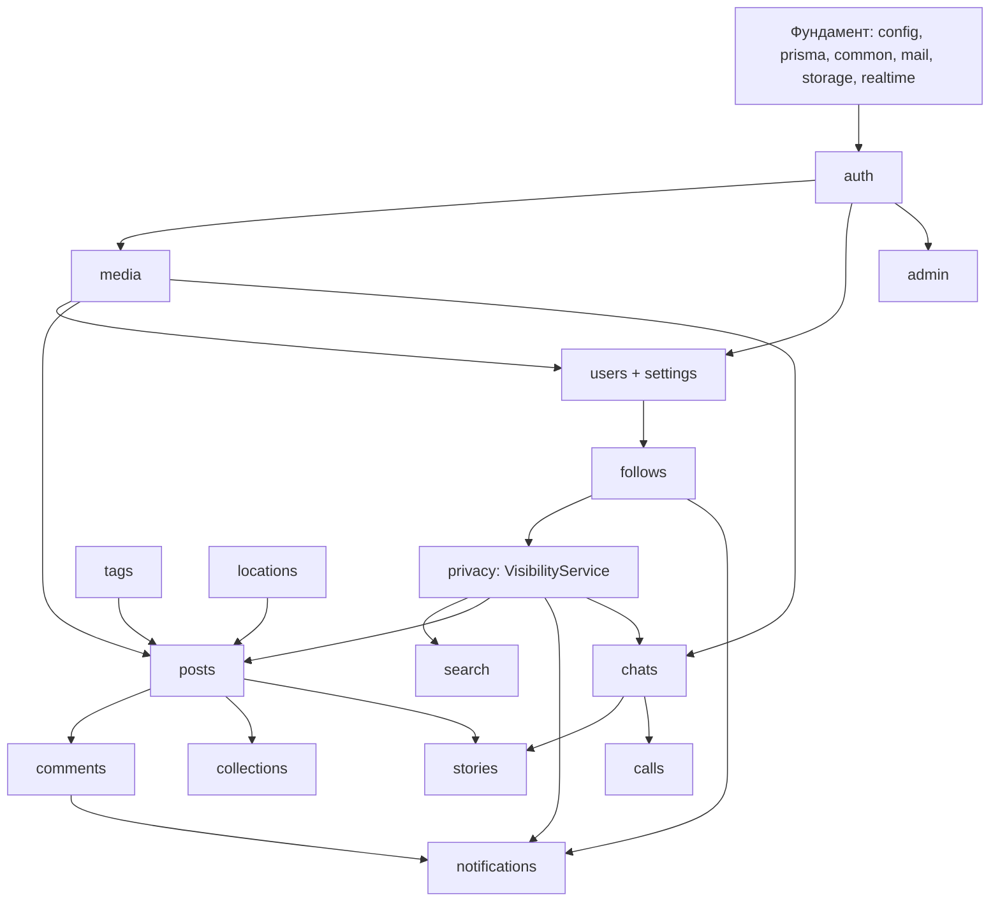

# План реализации

> Статус: ✅ утверждено 2026-10-22. **Студент A — JM-2007-07, Студент B — nek-yt** (Q26 решён).
> Текущее состояние задач — в [STATUS.md](STATUS.md). Реализация начинается с Phase 0.

## 1. Зависимости модулей

«Нижний слой» (`privacy`, `media`, `tags`, `notifications`, `realtime`) делается раньше функций, которые его используют.

## 2. Распределение модулей

### 2.1 Принцип

У каждого студента — **свой набор модулей целиком (backend + frontend)**, чтобы работать параллельно и не
конфликтовать в файлах. Каждый PR ревьюит второй студент — так оба понимают всё приложение.

- **Студент A (JM-2007-07) — «люди и общение»:** аккаунт, профиль (backend), подписки, приватность, настройки, поиск,
  комментарии, уведомления, реальное время, Direct, звонки, соцвход. Фундамент backend.
- **Студент B (nek-yt) — «контент и интерфейс»:** медиа, публикации и ленты, хэштеги, сохранённое, истории и актуальное,
  места, модерация. Фундамент frontend, дизайн-система, оболочка, страницы входа и профиля.

Почему так: в каждой фазе у обоих есть работа (A делает Direct, пока B делает истории), «нижний слой» распределён
по зависимостям (`realtime`, `privacy`, `notifications` — A; `media`, `tags` — B), а самые объёмные экраны
поделены поровну (A — Direct и уведомления, B — создание публикации, лента, истории).

### 2.2 Владельцы модулей

| Модуль backend (`apps/api/src/`) | Владелец | Папка frontend (`apps/web/src/`) | Владелец |
|---|---|---|---|
| `config`, `prisma`, `common`, `mail`, `health` | A | `lib/api/*`, `lib/store*`, `lib/design.ts`, `lib/utils.ts` | B |
| `realtime` | A | `lib/realtime.ts` | A |
| `storage`, `media` | B | `lib/api/upload.ts` | B |
| `auth` | A | `features/auth` (страницы входа и регистрации) | B |
| `users` | A | `features/profile` (страница профиля, редактирование) | B |
| `settings` | A | `features/settings` | A |
| `follows` | A | `features/follows` | A |
| `privacy` | A | `features/privacy` | A |
| `search` | A | `features/search` | A |
| `tags` | B | `features/tags`, `components/rich-text.tsx` | B |
| `posts` | B | `features/posts` (создание, лента, окно поста, «Интересное») | B |
| — | — | `features/reels` (лента Reels) | A |
| `comments` | A | `features/comments` | A |
| `collections` | B | `features/collections` | B |
| `notifications` | A | `features/notifications` | A |
| `stories` | B | `features/stories` | B |
| `chats` | A | `features/chat` | A |
| `calls` | A | `features/calls`, `lib/webrtc.ts` | A |
| `locations` | B | `features/locations` | B |
| `admin` | B | `features/admin` | B |
| — | — | `app/` (маршруты), `components/ui`, `components/layout`, `components/states`, `globals.css` | B (страницы своих функций создаёт владелец функции) |

Исключения из «модуль целиком» — осознанные, ради параллельной работы в первых фазах: страницы входа (`features/auth`)
и профиля (`features/profile`) делает B, пока A пишет backend `auth` и `users`; ленту Reels делает A, пока B занят
созданием публикаций и лентой. Контракт между ними — файл эндпоинтов модуля.

`schema.prisma`: модели модуля добавляет его владелец (DATA_MODEL.md, колонка «Модуль»), по очереди и по
[CHANGE_PROCESS.md](development/CHANGE_PROCESS.md).

### 2.3 Баланс нагрузки

Размер задачи: **S** = 1, **M** = 2, **L** = 3 условных единицы (совместные задачи делятся пополам).

| Фаза | Студент A | Студент B |
|---|---|---|
| 0 Фундамент | 7 (T0.1, T0.2, T0.4½, T0.5) | 7 (T0.3, T0.4½, T0.6, T0.7) |
| 1 Аккаунт и оболочка | 5 (T1.1, T1.2, T1.6) | 8 (T1.3, T1.4, T1.5) |
| 2 Профили и связи | 9 (T2.1, T2.2, T2.3, T2.5) | 5 (T2.4, T3.1 — начинается в Phase 2) |
| 3 Публикации | 8 (T3.6, T3.7, T3.8) | 11 (T3.2, T3.3, T3.4, T3.5) |
| 4 Direct ‖ 5 Истории | 9 (T4.1–T4.3) | 12 (T5.1–T5.5) |
| 6 Полный паритет | 11 (T6.1, T6.2, T6.3, T6.5, T6.6) | 7 (T6.4, T6.7, T6.8) |
| 7 Продакшен и защита | 5 (T7.2½, T7.3, T7.4½) | 4 (T7.1, T7.2½, T7.4½) |
| **Итого** | **54** | **54** |

P2-задачи (T6.9) делает владелец соответствующего модуля.

## 3. Задачи по фазам

ID `T<фаза>.<номер>`. «Готово, когда» — минимальное условие закрытия; полностью — критерии приёмки спецификации и
[Definition of Done](development/AGENT_PLAYBOOKS.md#definition-of-done). Ветки: `<тип>/<модуль>-<кратко>` (CONTRIBUTING.md).
Ревьюер каждой задачи — второй студент.

### Phase 0 — Фундамент

| ID | Задача | Кто | Размер | Зависит от | Готово, когда |
|---|---|---|---|---|---|
| T0.1 | Корень: Prettier, `concurrently`, общие правила форматирования | A | S | — | `npm install` проходит; `npx prettier --check .` работает |
| T0.2 | Каркас NestJS: структура, ESLint (правила границ ADR 0008), Jest, config, Prisma, префикс, `ValidationPipe`, фильтр ошибок, helmet, `Origin`, Swagger, `/health`, `openapi:export`, `mail` (драйвер log) | A | L | T0.1 | `GET /api/v1/health` = 200; lint/typecheck/test зелёные |
| T0.3 | Каркас Next.js: Tailwind, shadcn/ui, **токены DESIGN_SYSTEM (светлая/тёмная)**, ESLint, Vitest, rewrites, `lib/api/*`, store, `StoreProvider`, Toaster, `BrandLogo`, страница `/health` | B | L | T0.1 | страница в обеих темах; lint/typecheck/test зелёные |
| T0.4 | `api:types`, `npm run contract`, проверка прокси (cookie, Origin, multipart 650 МБ) → ADR 0004 | A + B | M | T0.2, T0.3 | `/health` через прокси; результат в ADR 0004 |
| T0.5 | Socket.IO: модуль `realtime` (cookie, `Origin`, комнаты `user:{id}`), `lib/realtime.ts`, проверка → ADR 0013 | A | M | T0.4 | тестовое событие доходит до вкладки; чужой `Origin` отклоняется |
| T0.6 | GitHub Actions: `npm ci`, lint, typecheck, test, контракт; защита `main` с обязательным ревью (CODEOWNERS) | B | M | T0.4 | PR с изменённым DTO без `contract` падает |
| T0.7 | Harness: проверка ссылок docs в CI, `.claude/settings.json` (запрет `.env`, сгенерированных файлов) | B | S | T0.6 | битая ссылка роняет CI |

T0.2 и T0.3 идут **параллельно**; общий файл — только `package-lock.json` (CONTRIBUTING.md).

### Phase 1 — Аккаунт и оболочка

| ID | Задача | Кто | Размер | Зависит от | Готово, когда |
|---|---|---|---|---|---|
| T1.1 | Модели `User`, `Session`, `PasswordResetToken`, `EmailVerificationCode`, `UserSettings`, `UsernameChange` — **первая миграция** | A | S | Phase 0 | миграция в `main` по DATA_MODEL |
| T1.2 | `auth`: регистрация + код, вход (имя/email), выход, сброс, смена, сессии, `SessionGuard`, throttler | A | L | T1.1 | критерии auth.md (без соцвхода, удаления) + e2e |
| T1.3 | `media` + `storage`: `MediaFile`, `POST /media`, проверка типа, sharp (EXIF, копии), раздача с проверкой доступа, очередь в процессе | B | L | T1.1 | загрузка фото → `READY`; чужой доступ → 404 |
| T1.4 | UI: вход, регистрация, код, сброс пароля (SCREENS 3.1–3.2) | B | M | контракт T1.2 | экраны совпадают с SCREENS; сценарии работают после влития T1.2 |
| T1.5 | Оболочка `(main)`: меню 72/238, мобильная навигация, «Ещё», тема, заставка, `proxy.ts`, проверка сессии | B | L | T1.2 | гость → `/accounts/login/`; оболочка по DESIGN_SYSTEM §4.1 |
| T1.6 | Seed: тестовые пользователи, администратор, места | A | S | T1.2 | `npm run prisma:seed -w api` |

### Phase 2 — Профили и связи

| ID | Задача | Кто | Размер | Зависит от | Готово, когда |
|---|---|---|---|---|---|
| T2.1 | `users`: `/me`, `PATCH /me`, аватар, ссылки, имя пользователя, email | A | M | T1.2, T1.3 | критерии users-and-profiles.md (backend) |
| T2.2 | `follows`: подписки, запросы, списки, удалить подписчика, рекомендации (+ UI кнопок и списков) | A | M | T2.1 | критерии follows.md (P0) |
| T2.3 | `privacy`: закрытый аккаунт, блокировка, `VisibilityService` (+ UI блокировки) | A | L | T2.2 | критерии privacy-and-safety.md (блок, закрытый) |
| T2.4 | UI профиля: шапка, вкладки, сетка-заглушка, редактирование профиля | B | L | контракт T2.1 | SCREENS 3.9 в обеих темах |
| T2.5 | `search`: поиск аккаунтов, история (#41–#49) + UI поиска | A | M | T2.3 | критерии search-and-explore.md (без «Интересного») |

### Phase 3 — Публикации, лента, комментарии, уведомления

| ID | Задача | Кто | Размер | Зависит от | Готово, когда |
|---|---|---|---|---|---|
| T3.1 | `tags`: разбор `#`/`@`, хэштеги, страница хэштега, подсказки, `RichText` — **начинается в Phase 2** | B | M | T1.2 (страница хэштега — после T2.3) | критерии hashtags-and-mentions.md |
| T3.2 | `posts` backend: карусель (фото + видео через ffmpeg), `shortcode`, просмотр, удаление, сетки профиля, лента, «Интересное», Reels | B | L | T1.3, T2.3, T3.1 | критерии posts.md (P0) |
| T3.3 | UI создания публикации: выбор, обрезка, подпись с подсказками, отметки, место, прогресс | B | L | T3.2 | SCREENS 3.6 |
| T3.4 | UI ленты: карточка, карусель, окно поста (`@modal`), сетка профиля, «Интересное» | B | L | T3.2 | SCREENS 3.3–3.5, 3.8 |
| T3.5 | Лайки (пост, двойной клик), воспроизведения, список лайков, сохранение | B | M | T3.2 | критерии post-interactions.md (лайки, сохранение) |
| T3.6 | `comments`: комментарии, ответы, лайки, удаление + UI | A | L | T3.2 | критерии post-interactions.md (комментарии P0) |
| T3.7 | `notifications`: создание, группировка, панель, значки, события | A | L | T0.5, T2.2, T3.5, T3.6 | критерии notifications.md |
| T3.8 | UI Reels: вертикальная лента, действия | A | M | T3.2 | SCREENS 3.7 |

### Phase 4 — Direct (A) ‖ Phase 5 — Истории и reels (B)

Фазы 4 и 5 идут **одновременно**: A делает Direct, B — истории. Ответы на истории (T5.1) используют контракт `chats`
из T4.1 — B работает по файлу эндпоинтов до влития.

| ID | Задача | Кто | Размер | Зависит от | Готово, когда |
|---|---|---|---|---|---|
| T4.1 | `chats` backend: личные/группы, сообщения, медиа, прочитано, запросы, события | A | L | T0.5, T1.3, T2.3 | критерии chat.md (backend) |
| T4.2 | UI Direct: список, переписка, отправка, оптимистичные сообщения, печатает, присутствие | A | L | T4.1 | SCREENS 3.11; сообщения < 1 с |
| T4.3 | Голосовые, реакции, ответы, редактирование, отмена, «поделиться», группы (UI) | A | L | T4.2 | критерии chat.md полностью |
| T5.1 | `stories` backend: создание, лента кругов, просмотр, зрители, лайки, ответы/реакции → Direct, архив | B | L | T3.2, контракт T4.1 | критерии stories.md (backend P0) |
| T5.2 | UI историй: лента кругов, просмотр, создание с редактором | B | L | T5.1 | SCREENS 3.10 |
| T5.3 | Стикеры: упоминание, место, хэштег, ссылка (P1); опрос, вопрос, шкала, викторина, отсчёт (P2) | B | M | T5.2 | ответы сохраняются, автор видит итоги |
| T5.4 | Актуальное: создание, просмотр, редактирование | B | M | T5.1 | критерии stories.md (актуальное) |
| T5.5 | Reels: обложка, вкладка профиля, счётчик воспроизведений | B | M | T3.8 | раздел reels posts.md |

### Phase 6 — Полный паритет

| ID | Задача | Кто | Размер | Зависит от | Готово, когда |
|---|---|---|---|---|---|
| T6.1 | Соцвход Google и Facebook (ADR 0014) | A | M | T1.2, Q32 | критерии auth.md (соцвход) |
| T6.2 | Звонки 1:1 (ADR 0015) | A | L | T4.2 | критерии calls.md |
| T6.3 | Ограничение, скрытие, близкие друзья, избранное, «скрыть историю от», ленты «Подписки»/«Избранное» | A | M | T2.3, T5.1 | критерии privacy-and-safety.md, follows.md |
| T6.4 | Редактирование, архив, закрепление публикаций; скрыть лайки; отключить комментарии; alt-текст; **подборки** | B | L | T3.2, T3.5 | критерии posts.md (P1), post-interactions.md (подборки) |
| T6.5 | Комментарии P1: закрепление, редактирование, одобрение ограниченных | A | M | T3.6 | критерии post-interactions.md (комментарии P1) |
| T6.6 | Настройки (все разделы), язык ru/en, удаление аккаунта, сессии в UI | A | M | T2.1 | критерии settings.md, auth.md |
| T6.7 | Места: страницы, выбор при публикации, администрирование | B | M | T3.2 | критерии locations.md |
| T6.8 | Жалобы и админ-панель | B | M | T3.2 | критерии moderation.md |
| T6.9 | P2 из каталога — делает владелец модуля: фильтры, соавторы (B); заметки, GIF, групповые звонки, 2FA, переключение аккаунтов, Web Push, сортировка комментариев, ваши действия, скачать данные (A) | A / B | — | по функции | отдельные критерии при постановке |

### Phase 7 — Продакшен и защита

| ID | Задача | Кто | Размер | Зависит от | Готово, когда |
|---|---|---|---|---|---|
| T7.1 | Playwright: сквозные сценарии (регистрация → пост → лайк → комментарий; Direct; история) | B | M | Phase 5 | зелёные в CI |
| T7.2 | Итоговая дизайн-сверка: каждый — экраны своих папок (SCREENS §0) | A + B | M | Phase 6 | отклонений нет или записаны |
| T7.3 | R2/S3, почтовый сервис, TURN, деплой с HTTPS (Q23–Q25, Q34) | A | L | Phase 6 | приложение доступно по HTTPS |
| T7.4 | Подготовка к защите: демо-данные, документы, сценарий, взаимное объяснение модулей | A + B | M | T7.1–T7.3 | QUALITY_CHECKLIST пройден |

Дизайн-сверка выполняется также **в каждой UI-задаче** (SCREENS §0), T7.2 — итоговая.

## 4. Правила интеграции

- Владелец модуля первым описывает изменения контракта в своём файле `docs/api/endpoints/<module>.md`, чтобы второй
  студент мог начать UI или зависимый модуль по согласованному контракту.
- Изменения `schema.prisma` — по очереди, по [CHANGE_PROCESS.md](development/CHANGE_PROCESS.md).
- Модули нижнего слоя (`privacy`, `media`, `tags`, `notifications`, `realtime`) меняются только с ревью второго студента.
- Раз в неделю — синхронизация: что влито, что блокирует, какие `Q` закрыты.
- В конце фазы — совместная проверка критериев из [ROADMAP.md](ROADMAP.md).
