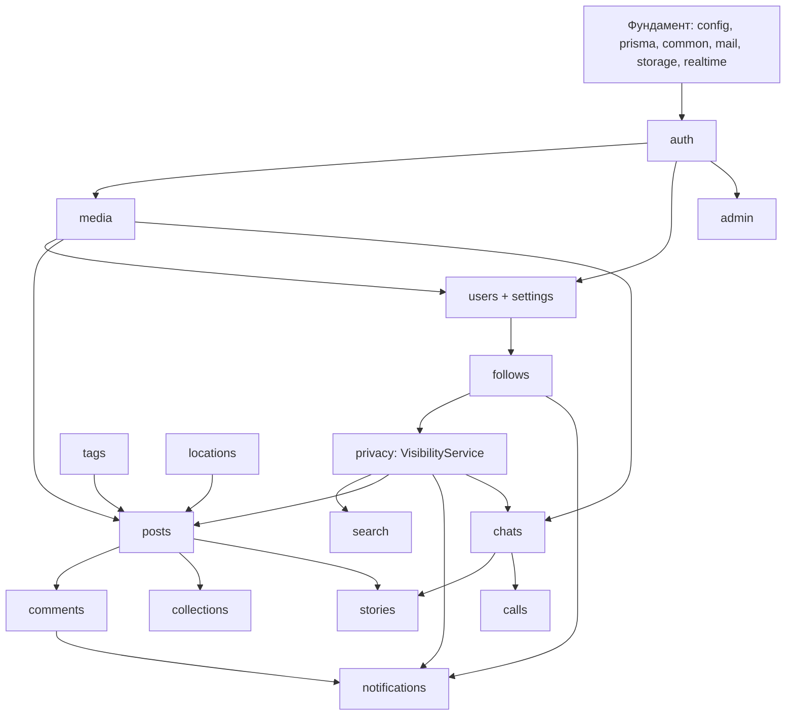

# План реализации

> Статус: 📝 обновлено 2026-10-21 под паритет с Instagram. **Владельцы задач — следующий шаг** (Q26): колонка «Кто»
> пока пустая. Текущее состояние задач — в [STATUS.md](STATUS.md). Реализация начинается только после одобрения.

## 1. Зависимости модулей

«Нижний слой» (`privacy`, `media`, `tags`, `notifications`, `realtime`) делается раньше функций, которые его используют.

## 2. Распределение модулей

Конкретные владельцы — следующий шаг (Q26). Принципы:

- Фундамент делится горизонтально: backend-фундамент — один студент, frontend-фундамент — другой, параллельно.
- Дальше — **модуль целиком (backend + frontend) у одного владельца**, каждый PR ревьюит второй.
- Общие модули нижнего слоя (`privacy`, `media`, `notifications`, `realtime`) получают одного владельца, второй — ревьюер.
- Нагрузка выравнивается по объёму UI: самые тяжёлые экраны — создание публикации, лента/окно поста, Direct, истории.
- Агенты ([AI_AGENTS.md](development/AI_AGENTS.md)) помогают обоим одинаково; модуль и владелец передаются в задании.

## 3. Задачи по фазам

ID `T<фаза>.<номер>`. «Готово, когда» — минимальное условие закрытия; полностью — критерии приёмки спецификации и
[Definition of Done](development/AGENT_PLAYBOOKS.md#definition-of-done). Ветки: `<тип>/<модуль>-<кратко>` (CONTRIBUTING.md).

### Phase 0 — Фундамент

| ID | Задача | Кто | Зависит от | Готово, когда |
|---|---|---|---|---|
| T0.1 | Корень: Prettier, `concurrently`, общие правила форматирования | — | — | `npm install` проходит; `npx prettier --check .` работает |
| T0.2 | Каркас NestJS: структура, ESLint (правила границ ADR 0008), Jest, config, Prisma, префикс, `ValidationPipe`, фильтр ошибок, helmet, `Origin`, Swagger, `/health`, `openapi:export`, `mail` (драйвер log) | — | T0.1 | `GET /api/v1/health` = 200; lint/typecheck/test зелёные |
| T0.3 | Каркас Next.js: Tailwind, shadcn/ui, **токены DESIGN_SYSTEM (светлая/тёмная)**, ESLint, Vitest, rewrites, `lib/api/*`, store, `StoreProvider`, Toaster, `BrandLogo`, страница `/health` | — | T0.1 | страница в обеих темах; lint/typecheck/test зелёные |
| T0.4 | `api:types`, `npm run contract`, проверка прокси (cookie, Origin, multipart 650 МБ) → ADR 0004 | — | T0.2, T0.3 | `/health` через прокси; результат в ADR 0004 |
| T0.5 | Socket.IO: модуль `realtime` (аутентификация cookie, `Origin`, комнаты `user:{id}`), `lib/realtime.ts`, проверка → ADR 0013 | — | T0.4 | тестовое событие доходит до вкладки; чужой `Origin` отклоняется |
| T0.6 | GitHub Actions: `npm ci`, lint, typecheck, test, контракт; защита `main` | — | T0.4 | PR с изменённым DTO без `contract` падает |
| T0.7 | Harness: проверка ссылок docs в CI, `.claude/settings.json` (запрет `.env`, сгенерированных файлов) | — | T0.6 | битая ссылка роняет CI |

### Phase 1 — Аккаунт и оболочка

| ID | Задача | Кто | Зависит от | Готово, когда |
|---|---|---|---|---|
| T1.1 | Модели `User`, `Session`, `PasswordResetToken`, `EmailVerificationCode`, `UserSettings`, `UsernameChange` — первая миграция | — | Phase 0 | миграция в `main` по DATA_MODEL |
| T1.2 | `auth`: регистрация + код, вход (имя/email), выход, сброс, смена, сессии, `SessionGuard`, throttler | — | T1.1 | критерии auth.md (без соцвхода, удаления) + e2e |
| T1.3 | `media` + `storage`: `MediaFile`, `POST /media`, проверка типа, sharp (EXIF, копии), раздача с проверкой доступа, очередь в процессе | — | T1.1 | загрузка фото → `READY`; чужой доступ → 404 |
| T1.4 | UI: вход, регистрация, код, сброс пароля (SCREENS 3.1–3.2) | — | T1.2 (контракт) | экраны совпадают с SCREENS; сценарии работают |
| T1.5 | Оболочка `(main)`: меню 72/238, мобильная навигация, «Ещё», переключение темы, заставка, `proxy.ts`, серверная проверка сессии | — | T1.2 | гость → `/accounts/login/`; оболочка совпадает с DESIGN_SYSTEM §4.1 |
| T1.6 | Seed: тестовые пользователи, администратор, места | — | T1.2 | `npm run prisma:seed -w api` |

### Phase 2 — Профили и связи

| ID | Задача | Кто | Зависит от | Готово, когда |
|---|---|---|---|---|
| T2.1 | `users`: `/me`, `PATCH /me`, аватар, ссылки, имя пользователя, email | — | T1.2, T1.3 | критерии users-and-profiles.md (backend) |
| T2.2 | `follows`: подписки, запросы, списки, удалить подписчика, рекомендации | — | T2.1 | критерии follows.md (P0) |
| T2.3 | `privacy`: закрытый аккаунт, блокировка, `VisibilityService` | — | T2.2 | критерии privacy-and-safety.md (блок, закрытый) |
| T2.4 | UI профиля: шапка, вкладки, сетка-заглушка, подписка, списки, редактирование профиля | — | T2.1–T2.3 | SCREENS 3.9 в обеих темах |
| T2.5 | `search`: поиск аккаунтов, история (#41–#49) + UI поиска | — | T2.3 | критерии search-and-explore.md (без «Интересного») |

### Phase 3 — Публикации, лента, комментарии, уведомления

| ID | Задача | Кто | Зависит от | Готово, когда |
|---|---|---|---|---|
| T3.1 | `tags`: разбор `#`/`@`, хэштеги, страница хэштега, подсказки | — | T2.3 | критерии hashtags-and-mentions.md |
| T3.2 | `posts` backend: создание карусели (фото + видео через ffmpeg), `shortcode`, просмотр, удаление, сетки профиля, лента, «Интересное», Reels | — | T1.3, T2.3, T3.1 | критерии posts.md (P0) |
| T3.3 | UI создания публикации: выбор, обрезка, подпись с подсказками, отметки, место, прогресс | — | T3.2 | SCREENS 3.6 |
| T3.4 | UI ленты: лента историй-заглушка, карточка, карусель, окно поста (`@modal`), сетка профиля, «Интересное» | — | T3.2 | SCREENS 3.3–3.5, 3.8 |
| T3.5 | Лайки (пост, двойной клик), воспроизведения, список лайков, сохранение | — | T3.2 | критерии post-interactions.md (лайки, сохранение) |
| T3.6 | `comments`: комментарии, ответы, лайки, удаление + UI | — | T3.2 | критерии post-interactions.md (комментарии P0) |
| T3.7 | `notifications`: создание, группировка, панель, значки, события | — | T0.5, T2.2, T3.5, T3.6 | критерии notifications.md |
| T3.8 | UI Reels: вертикальная лента, действия | — | T3.2 | SCREENS 3.7 |

### Phase 4 — Direct

| ID | Задача | Кто | Зависит от | Готово, когда |
|---|---|---|---|---|
| T4.1 | `chats` backend: личные/группы, сообщения, медиа, прочитано, запросы, события | — | T0.5, T1.3, T2.3 | критерии chat.md (backend) |
| T4.2 | UI Direct: список, переписка, отправка, оптимистичные сообщения, печатает, присутствие | — | T4.1 | SCREENS 3.11; сообщения < 1 с |
| T4.3 | Голосовые, реакции, ответы, редактирование, отмена, «поделиться», группы (UI) | — | T4.2 | критерии chat.md полностью |

### Phase 5 — Истории и reels

| ID | Задача | Кто | Зависит от | Готово, когда |
|---|---|---|---|---|
| T5.1 | `stories` backend: создание, лента кругов, просмотр, зрители, лайки, ответы/реакции → Direct, архив | — | T4.1, T3.2 | критерии stories.md (backend P0) |
| T5.2 | UI историй: лента кругов, просмотр, создание с редактором | — | T5.1 | SCREENS 3.10 |
| T5.3 | Стикеры: упоминание, место, хэштег, ссылка (P1); опрос, вопрос, шкала, викторина, отсчёт (P2) | — | T5.2 | ответы сохраняются, автор видит итоги |
| T5.4 | Актуальное: создание, просмотр, редактирование | — | T5.1 | критерии stories.md (актуальное) |
| T5.5 | Reels: обложка, вкладка профиля, счётчик воспроизведений | — | T3.8 | раздел reels posts.md |

### Phase 6 — Полный паритет

| ID | Задача | Кто | Зависит от | Готово, когда |
|---|---|---|---|---|
| T6.1 | Соцвход Google и Facebook (ADR 0014) | — | T1.2, Q32 | критерии auth.md (соцвход) |
| T6.2 | Звонки 1:1 (ADR 0015) | — | T4.2 | критерии calls.md |
| T6.3 | Ограничение, скрытие, близкие друзья, избранное, «скрыть историю от», ленты «Подписки»/«Избранное» | — | T2.3, T5.1 | критерии privacy-and-safety.md, follows.md |
| T6.4 | Редактирование, архив, закрепление публикаций; скрыть лайки; отключить комментарии; alt-текст | — | T3.2 | критерии posts.md (P1) |
| T6.5 | Комментарии: закрепление, редактирование, одобрение; подборки | — | T3.6, T3.5 | критерии post-interactions.md (P1) |
| T6.6 | Настройки (все разделы), язык ru/en, удаление аккаунта, сессии в UI | — | T2.1 | критерии settings.md, auth.md |
| T6.7 | Места: страницы, выбор при публикации, администрирование | — | T3.2 | критерии locations.md |
| T6.8 | Жалобы и админ-панель | — | T3.2 | критерии moderation.md |
| T6.9 | P2 из каталога: фильтры, соавторы, заметки, GIF, 2FA, групповые звонки, ваши действия, скачать данные, переключение аккаунтов, Web Push, сортировка комментариев | — | по функции | отдельные критерии при постановке |

### Phase 7 — Продакшен и защита

| ID | Задача | Кто | Зависит от | Готово, когда |
|---|---|---|---|---|
| T7.1 | Playwright: сквозные сценарии (регистрация → пост → лайк → комментарий; Direct; история) | — | Phase 5 | зелёные в CI |
| T7.2 | Итоговая дизайн-сверка всех экранов (SCREENS §0) | — | Phase 6 | отклонений нет или записаны |
| T7.3 | R2/S3, почтовый сервис, TURN, деплой с HTTPS (Q23–Q25, Q34) | — | Phase 6 | приложение доступно по HTTPS |
| T7.4 | Подготовка к защите: демо-данные, документы, сценарий | — | T7.1–T7.3 | QUALITY_CHECKLIST пройден |

Дизайн-сверка выполняется также **в каждой UI-задаче** (SCREENS §0), T7.2 — итоговая.

## 4. Правила интеграции

- Владелец модуля первым описывает изменения контракта в своём файле `docs/api/endpoints/<module>.md`, чтобы второй
  разработчик мог начать UI или зависимый модуль по согласованному контракту.
- Изменения `schema.prisma` — по очереди, по [CHANGE_PROCESS.md](development/CHANGE_PROCESS.md).
- Модули нижнего слоя (`privacy`, `media`, `notifications`, `realtime`) меняются только с ревью второго студента.
- Раз в неделю — синхронизация: что влито, что блокирует, какие `Q` закрыты.
- В конце фазы — совместная проверка критериев из [ROADMAP.md](ROADMAP.md).
