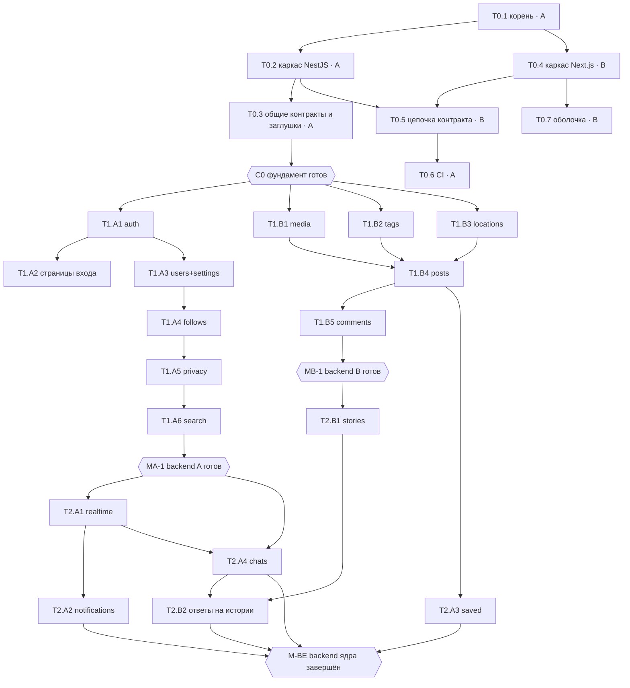

# План реализации (backend-first, два независимых потока)

> Статус: ✅ утверждено 2026-10-22, перестроено под backend-first. **Студент A — `JM-2007-07`, Студент B — `nek-yt`**
> (логины проверены через GitHub API). Статусы задач — **только** в [STATUS.md](STATUS.md); правила Git и общих
> файлов — в [CONTRIBUTING.md](../CONTRIBUTING.md). Решение о схеме и заглушках — [ADR 0018](decisions/0018-parallel-backend-workstreams.md).

## 1. Объём: обязательное и необязательное

Объём продукта не сокращается ([ADR 0011](decisions/0011-instagram-parity-scope.md)); для защиты задаётся порядок.

| Класс | Что входит | Где задачи |
|---|---|---|
| **R — требуется исходным Swagger** | все 57 операций (таблица в [API_CONTRACT.md §3](api/API_CONTRACT.md#3-таблица-соответствия-исходная-операция--новый-endpoint)) | Phase 1–2 |
| **N — необходимо для реализации и безопасности** | сессии и выход, подтверждение email, проверка прав и приватности (`VisibilityService`), безопасная загрузка и раздача медиа, валидация, единый формат ошибок, миграции, rate limit, Swagger | Phase 0–2 |
| **P0 — ядро паритета с Instagram** | функции P0 каталога: карусели, лента, комментарии с ответами, хэштеги, упоминания, истории, Direct с реальным временем, уведомления | Phase 1–3 |
| **Опционально — P1/P2** | соцвход, звонки, ограничение/скрытие/близкие друзья, подборки, правка и архив публикаций, стикеры кроме базовых, админ-панель, фильтры, 2FA, заметки, GIF | Phase 4 — **не блокирует** контрольные точки |

Контрольная точка «backend завершён» (M-BE) и «frontend ядра завершён» (M-FE) требуют только R + N + P0.

## 2. Потоки работ

**Студент A (`JM-2007-07`) — «аккаунт, люди, общение»:** фундамент backend (единственный владелец корневой
конфигурации и `apps/api` foundation), `auth`, `users` + `settings`, `follows`, `privacy`, `search`, `collections`,
`realtime`, `notifications`, `chats`, `calls` (опц.). Frontend своих модулей.

**Студент B (`nek-yt`) — «контент и интерфейс»:** фундамент frontend (дизайн-токены, `lib/api`, оболочка),
цепочка контракта, `media` + `storage`, `tags`, `locations`, `posts` (лента, «Интересное», reels, лайки, воспроизведения),
`comments`, `stories` + актуальное, `admin` (опц.). Frontend своих модулей.

Изменения относительно распределения от 2026-10-22 утра (и почему):

| Что | Было | Стало | Почему |
|---|---|---|---|
| `comments` | A | **B** | комментарии — часть публикаций; без перекрёстной зависимости posts ↔ comments |
| `collections` (сохранённое) | B | **A** | баланс; модуль маленький и зависит только от DTO публикации |
| страницы входа, профиля | B | **A** | backend-first: каждый делает frontend **своих** модулей |
| лента Reels (UI) | A | **B** | тот же принцип: reels — модуль `posts` |
| совместные задачи «A + B» | были | **нет** | у каждой задачи один владелец |

### 2.1 Нагрузка (S = 1, M = 2, L = 3)

| Фаза | A | B |
|---|---|---|
| 0 — общий фундамент | 8 | 7 |
| 1 — независимый backend | 14 | 13 |
| 2 — зависимый backend | 9 | 4 |
| 3 — frontend своих модулей | 11 | 15 |
| **Обязательное итого** | **42** | **39** |
| 4 — опционально | 13 | 11 |
| 5 — выпуск | 5 | 6 |

## 3. Зависимости и контрольные точки

| Точка | Условие | Что открывает |
|---|---|---|
| **C0** — фундамент готов | T0.2 и T0.3 влиты в `main` (контракты общих сервисов зафиксированы) | оба начинают Phase 1 |
| **MA-1** — backend A готов для frontend A | T1.A1, T1.A3–T1.A6 влиты; Swagger модулей стабилен; e2e зелёные | frontend профиля, настроек, подписок, поиска (T3.A1–T3.A3) |
| **MB-1** — backend B готов для frontend B | T1.B1–T1.B5 влиты; Swagger стабилен; e2e зелёные; вход доступен (T1.A1 + T1.A2) | frontend ленты, публикаций, комментариев, «Интересного», reels (T3.B1–T3.B5) |
| **MA-2** — Direct готов | T2.A1, T2.A4 влиты | UI Direct (T3.A5) |
| **MB-2** — истории готовы | T2.B1 влита (ответы — после T2.B2) | UI историй (T3.B6) |
| **M-BE** — backend ядра завершён | все задачи Phase 0–2 влиты + критерии §6 | — (frontend не ждёт M-BE) |
| **M-FE** — frontend ядра завершён | все задачи Phase 3 влиты | Phase 4, 5 |

**Frontend не ждёт чужого backend целиком.** Каждый начинает frontend своих модулей на своей точке MA-1 / MB-1.
Если один студент дошёл до точки раньше, он продолжает свой следующий backend (Phase 2), а не ждёт.

### 3.1 Как не ждать друг друга: заглушки и контракты

Всё, что модуль одного студента вызывает у другого, существует с C0 как **настоящий класс с простейшим поведением**
(не копия и не второй вариант). Владелец потом заменяет тело методов, сигнатура не меняется.

| Интерфейс (владелец) | Появляется в | Поведение до реализации | Реальная реализация |
|---|---|---|---|
| `SessionGuard`, `@CurrentUser()`, `SessionUser` (A) | T0.3 | настоящая проверка сессии по таблице `Session` | — |
| `UserSummaryDto`, `UsersService.toSummary()` (A) | T0.3 | поля из `User`; `hasActiveStory = false` | T1.A3 (+ истории — T2.B1 через интерфейс) |
| `VisibilityService` (A) | T0.3 | всё видно всем вошедшим | T1.A5 — блокировки, закрытые аккаунты, аудитория |
| `NotificationsService.create()` (A) | T0.3 | запись в лог | T2.A2 |
| `RealtimeService.emitToUsers()` (A) | T0.3 | ничего не делает | T2.A1 |
| `MediaService.attach()`, `toMediaItem()` (B) | T1.B1 | — (модуль сразу настоящий) | T1.B1 |
| `PostsService.toPostDto()` (B) | T1.B4 | — | T1.B4 |
| `ChatsService.sendSystemMessage()` для ответов на истории (A) | T2.A4 | — | T2.A4; B подключает в T2.B2 |
| Тестовые помощники `createUser()`, `loginAs()` (A) | T0.3 | e2e-тесты B создают пользователя и cookie без страниц входа | — |

**Сигнатуры заглушек (зафиксированы в T0.3, после C0 не меняются):**

| Сервис | Метод | До реализации |
|---|---|---|
| `VisibilityService` (`src/privacy`) | `canViewProfile(viewerId, ownerId): Promise<boolean>`, `canViewContent(viewerId, ownerId): Promise<boolean>` | `true` |
| | `assertCanViewProfile(viewerId, ownerId)` — бросает 404; `assertCanViewContent(viewerId, ownerId)` — 404 или 403 `PRIVATE_ACCOUNT` | не бросают |
| | `getHiddenUserIds(viewerId): Promise<string[]>`; `visibleUserWhere(viewerId): Prisma.UserWhereInput` (для `where` в своих запросах) | `[]`, `{}` |
| | **Добавлено в T1.A5:** `visibleAuthorWhere(viewerId): Prisma.UserWhereInput` — для `where` по автору контента: нет блокировок И (сам viewer, или открытый аккаунт, или viewer — ACCEPTED-подписчик), напр. `where: { author: visibility.visibleAuthorWhere(viewerId) }`; `visibleUserWhere` теперь = ACTIVE + подтверждён + без блокировок в обе стороны | настоящая |
| `NotificationsService` (`src/notifications`) | `create({ recipientId, actorId, type, postId?, commentId?, storyId? }): Promise<void>` | запись в лог |
| `RealtimeService` (`src/realtime`) | `emitToUsers(userIds, event, payload): void` | ничего |
| `SessionService` (`src/common/session`) | `@CurrentUser()` → `SessionUser { id, role, sessionId }` | настоящая |
| `UsersService` (`src/users`) | `toSummary(row)` + `userSummarySelect` → `UserSummaryDto` | `avatarUrl = null`, `hasActiveStory = false` |
| тесты (`test/helpers`) | `createTestApp()`, `resetDb(app)`, `createUser(app, overrides?)`, `loginAs(app, user)` → `'sid=…'`, `ORIGIN` | настоящие |

Модули этих сервисов глобальные (`@Global`): импортировать их в свой модуль не нужно.

Пока реальной реализации нет, e2e-тесты владельца вызывающего модуля проверяют **свою** логику; проверки приватности
своих выдач он добавляет после влития T1.A5 (это часть его Definition of Done).

## 4. Карточки модулей

Общие для всех: Definition of Done — [AGENT_PLAYBOOKS.md](development/AGENT_PLAYBOOKS.md#definition-of-done)
(тесты по [TESTING.md](development/TESTING.md), Swagger, `npm run contract`, своя схема и миграция, история, STATUS).
Общие файлы и их владельцы — [CONTRIBUTING.md «Общие файлы»](../CONTRIBUTING.md#общие-файлы).
Схема БД — многофайловая: модели модуля лежат в `apps/api/prisma/schema/<module>.prisma` (ADR 0018).

### Фундамент backend — A · N
- **Назначение:** каркас NestJS, конфигурация, Prisma, общие механизмы, контракты общих сервисов.
- **Файлы:** `apps/api/{package.json,nest-cli.json,tsconfig*.json,prisma.config.ts}`, `src/{main.ts,app.module.ts}`, `src/{config,prisma,common,mail,health}/**`,
  `prisma/schema/base.prisma` (generator, datasource), `prisma/schema/account.prisma` (User, Session — T0.3), `prisma/seed.ts`, `test/helpers/**`.
- **Модели:** `User` (без полей профиля из других модулей), `Session`, `UserSettings`.
- **Готово, когда:** `/api/v1/health` = 200; ошибки в формате API_CONTRACT §1.2; Swagger экспортируется; заглушки §3.1 есть и покрыты тестом сигнатуры.
- **Блокирует второго:** да — C0 нужен B для backend.

### `auth` — A · R + N (#1–#5) — [спецификация](features/auth.md), [эндпоинты](api/endpoints/auth.md)
- **Файлы:** `src/auth/**`, `prisma/schema/auth.prisma` (EmailVerificationCode, PasswordResetToken, UsernameChange, OAuthAccount — в T4.A1), `test/auth*.e2e-spec.ts`.
- **Права:** Public — регистрация, код, вход, сброс; остальное — сессия. **Интеграция:** создаёт сессии для `SessionGuard`.
- **Блокирует второго:** frontend B — только страница входа (T1.A2) для ручной проверки; backend B — нет (тесты через `loginAs()`).

### `users` + `settings` — A · R (#50 свой, #51–#54, #56, #57) + P0 — [спецификации](features/users-and-profiles.md), [settings](features/settings.md)
- **Файлы:** `src/{users,settings}/**`, `prisma/schema/users.prisma` (UserLink; поля профиля `User` — в `account.prisma`, A), `prisma/schema/settings.prisma`.
- **Зависит от:** T1.A1; аватар — от `MediaService` (T1.B1): эндпоинты аватара делаются последними в задаче.
- **Блокирует второго:** frontend B — `GET /me` для оболочки (T0.7 работает по контракту до влития).

### `follows` — A · R (#12–#15) + P0 — [спецификация](features/follows.md)
- **Файлы:** `src/follows/**`, `prisma/schema/follows.prisma` (Follow, CloseFriend, FavoriteAccount).
- **Интеграция:** `FollowsService.getFollowingIds()` для ленты (B) и ленты историй (B). **Блокирует второго:** лента (T1.B4) до влития показывает только свои посты — допустимое промежуточное поведение, описанное в задаче.

### `privacy` — A · N + P0 — [спецификация](features/privacy-and-safety.md), [эндпоинты](api/endpoints/privacy.md)
- **Файлы:** `src/privacy/**`, `prisma/schema/privacy.prisma` (Block, Restrict, Mute, StoryHiddenFrom, HiddenWord).
- **Интеграция:** настоящая реализация `VisibilityService` — все модули B начинают учитывать приватность без своих изменений.

### `search` — A · R (#41–#49) — [спецификация](features/search-and-explore.md), [эндпоинты](api/endpoints/search.md)
- **Файлы:** `src/search/**`, `prisma/schema/search.prisma` (SearchHistoryEntry).
- **Зависит от:** T1.A5; поиск хэштегов и мест — читает таблицы B (`Hashtag`, `Location`) после T1.B2/T1.B3.

### `collections` (сохранённое) — A · R (#32, #55) + P1 подборки — [эндпоинты](api/endpoints/collections.md)
- **Файлы:** `src/collections/**`, `prisma/schema/collections.prisma`. **Зависит от:** `PostsService.toPostDto()` (T1.B4).

### `realtime` — A · P0 — [REALTIME.md](api/REALTIME.md), ADR 0013
- **Файлы:** `src/realtime/**`, `apps/web/src/lib/realtime.ts`. **Интеграция:** настоящий `RealtimeService`.

### `notifications` — A · P0 — [спецификация](features/notifications.md)
- **Файлы:** `src/notifications/**`, `prisma/schema/notifications.prisma`. **Интеграция:** модули B уже вызывают `create()` в точках из контракта.

### `chats` — A · R (#6–#11) + P0 — [спецификация](features/chat.md), [эндпоинты](api/endpoints/chats.md)
- **Файлы:** `src/chats/**`, `prisma/schema/chats.prisma`. **Зависит от:** `realtime`, `privacy`, `media`.
- **Блокирует второго:** ответы на истории (T2.B2).

### `calls` — A · опционально — [спецификация](features/calls.md)
- **Файлы:** `src/calls/**`, `prisma/schema/calls.prisma`, `apps/web/src/lib/webrtc.ts`.

### Фундамент frontend — B · N
- **Файлы:** `apps/web/**` каркас, `src/app/{layout.tsx,globals.css}`, `src/lib/{api,store*,design.ts,utils.ts}`, `src/components/{ui,layout,states}/**`,
  `src/app/(main)/layout.tsx`, `src/proxy.ts`, `next.config.ts`; цепочка `npm run contract`.
- **Блокирует второго:** да — frontend A строится на нём (готов в Phase 0).

### `media` + `storage` — B · R (#9, #26, #38, #56 — загрузка) + N — [эндпоинты](api/endpoints/media.md), ADR 0007, 0016
- **Файлы:** `src/{media,storage}/**`, `prisma/schema/media.prisma` (MediaFile), `test/media*.e2e-spec.ts`.
- **Интеграция:** `MediaService.attach()`, `toMediaItem()`; доступ к файлу — через `VisibilityService` и владельца объекта.
- **Блокирует второго:** аватар (T1.A3) и вложения Direct (T2.A4).

### `tags` — B · P0 — [спецификация](features/hashtags-and-mentions.md)
- **Файлы:** `src/tags/**`, `prisma/schema/tags.prisma` (Hashtag, PostHashtag, PostMention, CommentMention), `apps/web/src/components/rich-text.tsx` (в Phase 3).
- **Интеграция:** `TagsService.parse(text)` — им пользуются `users` (bio, A) и `chats` (A).

### `locations` — B · R (#16–#20) — [спецификация](features/locations.md)
- **Файлы:** `src/locations/**`, `prisma/schema/locations.prisma`; seed мест — `prisma/seed/locations.ts`.

### `posts` — B · R (#21–#29) + P0 — [спецификация](features/posts.md), [эндпоинты](api/endpoints/posts.md)
- **Файлы:** `src/posts/**`, `prisma/schema/posts.prisma` (Post, PostMedia, PostUserTag, PostCollaborator, PostLike, PostPlay).
- **Интеграция:** `PostsService.toPostDto()`; вызывает `NotificationsService.create()` (лайк, отметка, упоминание), `VisibilityService`, `FollowsService`.

### `comments` — B · R (#30, #31) + P0 — [спецификация](features/post-interactions.md), [эндпоинты](api/endpoints/comments.md)
- **Файлы:** `src/comments/**`, `prisma/schema/comments.prisma` (Comment, CommentLike).

### `stories` — B · R (#33–#40) + P0/P1 (актуальное) — [спецификация](features/stories.md), [эндпоинты](api/endpoints/stories.md)
- **Файлы:** `src/stories/**`, `prisma/schema/stories.prisma`.
- **Зависит от:** `media`, `posts`, `follows`; ответы и реакции — `chats` (T2.B2).

### `admin` — B · опционально (кроме #50 Admin-удаления — R) — [спецификация](features/moderation.md)
- **Файлы:** `src/admin/**`, `prisma/schema/admin.prisma` (Report).

## 5. Задачи

ID: `T<фаза>.<номер>` в Phase 0, `T<фаза>.<A|B><номер>` дальше — буква = владелец. Ревьюер каждой задачи — второй студент.
Ветка задачи: `<тип>/<модуль>-<кратко>` от свежего `main`. «Готово, когда» — минимум; полностью — критерии спецификации.

### Phase 0 — общий фундамент (маленький, у каждой задачи один владелец)

| ID | Задача | Кто | Размер | Зависит от | Готово, когда |
|---|---|---|---|---|---|
| T0.1 | Корень: Prettier, `concurrently`, проверка `npm install` | A | S | — | `npm install` проходит; `npx prettier --check .` работает |
| T0.2 | Каркас NestJS: config (валидация env), Prisma 7 (`prisma@7`, многофайловая схема `prisma/schema/`), `common` (фильтр ошибок, `ValidationPipe`, `Origin`, курсоры, `@Public`), helmet, `/health`, Swagger + `openapi:export`, `mail` (log), ESLint с правилами границ, Jest | A | L | T0.1 | `/api/v1/health` = 200; `npm run lint/typecheck/test -w api` зелёные |
| T0.3 | Общие контракты: модели `User`, `Session`, `UserSettings` + первая миграция; `SessionGuard`, `@CurrentUser`; `UserSummaryDto`; заглушки `VisibilityService`, `NotificationsService`, `RealtimeService`; `test/helpers` (`createUser`, `loginAs`); базовый seed | A | M | T0.2 | **C0**: B может писать модуль и e2e-тест с вошедшим пользователем |
| T0.4 | Каркас Next.js: Tailwind, shadcn/ui, токены DESIGN_SYSTEM (обе темы), `lib/api` (baseApi, types, errors, serverFetch, upload), store, Toaster, `BrandLogo`, ESLint, Vitest, rewrites | B | L | T0.1 | страница `/health`-заглушка в обеих темах; lint/typecheck/test зелёные |
| T0.5 | `api:types`, `npm run contract`, проверка прокси (cookie, Origin, multipart 650 МБ) → обновить ADR 0004 | B | M | T0.2, T0.4 | `/health` через прокси; результат записан |
| T0.6 | GitHub Actions: `npm ci`, lint, typecheck, unit + e2e с PostgreSQL, проверка контракта, проверка ссылок docs; защита `main` (обязательное ревью CODEOWNERS); `.claude/settings.json` | A | M | T0.5 | PR с изменённым DTO без `contract` или с битой ссылкой падает |
| T0.7 | Оболочка `(main)`: меню 72/238, мобильная навигация, «Ещё», тема, заставка, `proxy.ts`, проверка сессии через `serverFetch('/me')` (по контракту) | B | M | T0.4 | оболочка по DESIGN_SYSTEM §4.1; гость → `/accounts/login/` |

### Phase 1 — независимый backend (параллельно)

| ID | Задача | Кто | Размер | Зависит от | Готово, когда |
|---|---|---|---|---|---|
| T1.A1 | `auth`: регистрация + код, вход (имя/email), выход, сброс, смена пароля, сессии, throttler | A | L | C0 | критерии auth.md (кроме соцвхода, удаления); e2e |
| T1.A2 | Frontend входа: вход, регистрация, код, сброс (SCREENS 3.1–3.2) — раньше остального frontend A, потому что вход нужен обоим | A | M | T1.A1, T0.4 | вход через UI создаёт сессию; экраны по SCREENS |
| T1.A3 | `users` + `settings`: `/me`, `PATCH /me`, имя пользователя, email, ссылки, профиль по id/имени, настройки; затем аватар | A | M | T1.A1; аватар — T1.B1 | критерии users-and-profiles.md (backend), settings.md (backend) |
| T1.A4 | `follows`: подписки, запросы, списки, удалить подписчика, рекомендации | A | M | T1.A3 | критерии follows.md (backend P0) |
| T1.A5 | `privacy`: закрытый аккаунт, блокировка, настоящий `VisibilityService` | A | L | T1.A4 | критерии privacy-and-safety.md (блок, закрытый) для всех существующих выдач |
| T1.A6 | `search`: поиск аккаунтов, общий поиск, подсказки `@`, история поиска (#41–#49) | A | M | T1.A5 (хэштеги/места — после T1.B2/T1.B3) | критерии search-and-explore.md (backend) |
| T1.B1 | `media` + `storage`: `POST /media`, проверка по содержимому, sharp, ffmpeg, очередь, раздача с проверкой доступа, `MediaService` | B | L | C0 (часть без HTTP — после T0.2); ffmpeg | загрузка фото и видео → `READY`; чужой доступ → 404 |
| T1.B2 | `tags`: разбор `#`/`@`, хэштеги, `TagsService.parse()`, страница хэштега (выдача — после T1.B4) | B | M | C0 | критерии hashtags-and-mentions.md (backend) |
| T1.B3 | `locations`: справочник, поиск, CRUD для `ADMIN`, seed мест | B | M | C0 | критерии locations.md (без страницы места) |
| T1.B4 | `posts`: карусель (фото/видео), `shortcode`, просмотр, удаление, сетки профиля, лента, «Интересное», reels, лайки, воспроизведения, `toPostDto()` | B | L | T1.B1, T1.B2, T1.B3 | критерии posts.md (backend P0); `NotificationsService.create()` вызывается в точках контракта |
| T1.B5 | `comments`: комментарии, ответы, лайки, удаление | B | L | T1.B4 | критерии post-interactions.md (комментарии P0, backend) |

### Phase 2 — зависимый backend

| ID | Задача | Кто | Размер | Зависит от | Готово, когда |
|---|---|---|---|---|---|
| T2.A1 | `realtime`: Socket.IO (cookie, `Origin`, комнаты, присутствие), настоящий `RealtimeService`, `lib/realtime.ts` | A | M | C0 | тестовое событие доходит до вкладки; чужой `Origin` отклоняется (ADR 0013) |
| T2.A2 | `notifications`: модель, создание с учётом настроек и приватности, группировка, список, значки, события | A | L | T1.A4, T2.A1, T1.B4, T1.B5 | критерии notifications.md (backend) |
| T2.A3 | `collections`: сохранить/убрать, «Сохранённое» (#32, #55) | A | S | T1.B4 | критерии post-interactions.md (сохранение) |
| T2.A4 | `chats`: личные и групповые, сообщения (текст, медиа, голосовые, «поделиться»), реакции, правка, отмена, прочитано, запросы, события; `ChatsService` для историй | A | L | T2.A1, T1.A5, T1.B1 | критерии chat.md (backend) |
| T2.B1 | `stories`: создание (медиа или пост), лента кругов, просмотр, зрители, лайки, архив, актуальное, базовые стикеры (упоминание, место, хэштег, ссылка) | B | L | T1.B4, T1.A4 | критерии stories.md (backend P0 + актуальное) |
| T2.B2 | Ответы и реакции на истории → Direct (`ChatsService`) | B | S | T2.B1, T2.A4 | ответ создаёт сообщение в личном чате с автором |

### Phase 3 — frontend своих модулей (начинается на своей точке, не на M-BE)

| ID | Задача | Кто | Размер | Можно начать | Готово, когда |
|---|---|---|---|---|---|
| T3.A1 | Профиль (шапка, вкладки; сетку даёт компонент B `ProfilePostsGrid`, до него — заглушка), редактирование профиля, настройки | A | L | MA-1 | SCREENS 3.9, 3.14 |
| T3.A2 | Подписки и списки, блокировка, поиск и история поиска | A | M | MA-1 | критерии follows, privacy, search (UI) |
| T3.A3 | Уведомления: панель, значки, события | A | M | T2.A2 | SCREENS 3.13 |
| T3.A4 | «Сохранённое» на профиле | A | S | T2.A3, T3.B1 (карточки) | вкладка по SCREENS |
| T3.A5 | Direct: список, переписка, отправка, голосовые, реакции, печатает, присутствие | A | L | MA-2 | SCREENS 3.11; сообщения < 1 с |
| T3.B1 | Лента, карточка поста, окно поста (`@modal`), `ProfilePostsGrid`, лайки и двойной клик | B | L | MB-1 | SCREENS 3.3–3.5 |
| T3.B2 | Создание публикации: выбор, обрезка, подпись с подсказками, отметки, место, прогресс | B | L | MB-1 | SCREENS 3.6 |
| T3.B3 | «Интересное», страницы хэштега и места | B | M | MB-1 | SCREENS 3.8 |
| T3.B4 | Лента Reels | B | M | MB-1 | SCREENS 3.7 |
| T3.B5 | Комментарии и ответы в окне поста | B | M | MB-1 | критерии post-interactions.md (UI) |
| T3.B6 | Истории: лента кругов, просмотр, создание, актуальное | B | L | MB-2 | SCREENS 3.10 |

### Phase 4 — опционально (P1/P2), не блокирует M-BE и M-FE

| ID | Задача | Кто | Размер |
|---|---|---|---|
| T4.A1 | Соцвход Google и Facebook (ADR 0014; Q32) | A | M |
| T4.A2 | Звонки 1:1 (ADR 0015) | A | L |
| T4.A3 | Ограничение, скрытие, близкие друзья, избранное, «скрыть историю от» | A | M |
| T4.A4 | Удаление и деактивация аккаунта, сессии в UI, 2FA | A | M |
| T4.A5 | Подборки сохранённого (P1) | A | M |
| T4.A6 | Direct P1/P2 в UI: группы, заметки, GIF | A | M |
| T4.B1 | Правка, архив, закрепление публикаций; скрыть лайки; отключить комментарии; alt; ленты «Подписки»/«Избранное»; соавторы | B | L |
| T4.B2 | Комментарии P1: закрепление, правка, одобрение | B | M |
| T4.B3 | Редактор историй и стикеры P2 (опрос, вопрос, шкала, викторина, отсчёт) | B | M |
| T4.B4 | Жалобы и админ-панель | B | M |
| T4.B5 | Обрезка и фильтры изображений | B | M |

### Phase 5 — выпуск и защита

| ID | Задача | Кто | Размер |
|---|---|---|---|
| T5.A1 | Почтовый сервис, TURN, деплой с HTTPS (Q23, Q24, Q34) | A | L |
| T5.A2 | Дизайн-сверка своих экранов (SCREENS §0) | A | S |
| T5.A3 | Подготовка к защите: демо-данные своих модулей, объяснение модулей B | A | S |
| T5.B1 | Playwright: сквозные сценарии | B | M |
| T5.B2 | Драйвер хранилища `s3` (R2/S3, Q25) | B | M |
| T5.B3 | Дизайн-сверка своих экранов (SCREENS §0) | B | S |
| T5.B4 | Подготовка к защите: демо-данные своих модулей, объяснение модулей A | B | S |

## 6. Backend завершён (M-BE)

- Все операции R (57) и функции P0 backend реализованы; DTO и ответы описаны в Swagger; `npm run contract` без расхождений.
- Аутентификация и проверка прав на уровне объектов работают; e2e-тесты приватности для каждой выдачи.
- Миграции воспроизводимы: пустая БД → `npm run prisma:migrate -w api` → `npm run prisma:seed -w api` без ошибок.
- Загрузка и раздача медиа работают (фото, видео, голосовые).
- Критические сценарии проверены e2e: регистрация → вход → публикация → комментарий → лайк → уведомление; Direct; история.
- Оба студента запускают объединённый backend по [LOCAL_SETUP.md](development/LOCAL_SETUP.md).

## 7. Точки интеграции

| Когда | Что делают оба |
|---|---|
| C0 | оба запускают `main` локально; B пишет первый e2e-тест с `loginAs()` |
| MA-1 / MB-1 | совместный прогон: регистрация через UI → публикация → комментарий; проверка приватности на публикациях B |
| M-BE | прогон §6 на чистой БД у каждого; обновить STATUS и историю |
| еженедельно | 15 минут: что влито, что блокирует, какие `Q` закрыты, кто меняет общие файлы на неделе |

## 8. С чего начать

| Студент | Первая задача | Ветка | Потом |
|---|---|---|---|
| A (`JM-2007-07`) | T0.1 → T0.2 → T0.3 (C0) | `chore/root-tooling`, `feat/api-foundation`, `feat/api-core-contracts` | T0.6, T1.A1 |
| B (`nek-yt`) | T0.4 (параллельно с T0.2 — после T0.1) | `feat/web-foundation` | T0.5, T0.7, затем T1.B1 (часть без HTTP — сразу после T0.2) |
