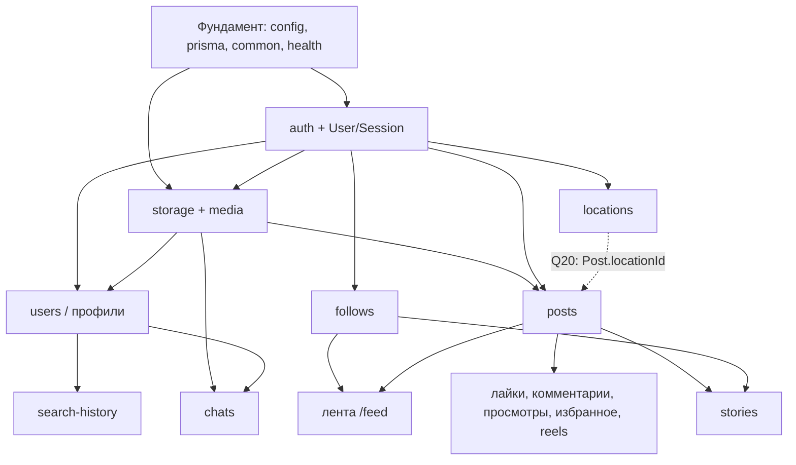

# План реализации и распределение работы

> Статус: 📝 предложено. Имена ролей — **Студент A** и **Студент B**; кто есть кто — решаете вы (Q26).
> Реализация начинается только после одобрения этого плана.

## 1. Зависимости модулей

## 2. Распределение модулей

Принцип: **после общего фундамента каждый ведёт свои модули целиком (backend + frontend)**.
Так модули развиваются параллельно, а каждый студент понимает полный путь запроса.
Чтобы оба могли объяснить всё приложение, каждый PR ревьюит второй студент.

| Модуль | Владелец | Почему так |
|---|---|---|
| Фундамент backend (`apps/api` каркас, config, prisma, common, Swagger) | **A** | один владелец общей инфраструктуры backend |
| Фундамент frontend (`apps/web` каркас, shadcn/ui, `lib/api`, providers, оболочка) | **B** | один владелец общей инфраструктуры frontend |
| Корневые конфигурации, CI | **A** (ревью B) | |
| `auth` backend (сессии, guard, пароли) | **A** | критический путь; первый за фундаментом backend |
| страницы `(auth)` и оболочка `(main)` | **B** | единственное исключение из «модуль целиком»: в Phase 1 B делает UI входа параллельно с backend A по согласованному контракту |
| `storage` + `media` | **B** | нужен постам и сторис (модули B); первый backend-модуль B |
| `users` / профили / поиск пользователей | **A** | продолжение auth |
| `follows` | **A** | связан с профилем |
| `search-history` | **A** | связан с поиском пользователей |
| `locations` | **A** | независимый, небольшой |
| `chats` | **A** | зависит от users и media |
| `posts`, лента, «Интересное», reels | **B** | основной контент |
| лайки, комментарии, просмотры, избранное | **B** | внутри модуля posts |
| `stories` | **B** | зависит от posts и media |
| `notifications` (если одобрено, Q21) | решается в Phase 6 | |

Нагрузка: у A больше модулей, у B — более объёмный UI (лента, создание постов, сторис). При заметном
перекосе модуль передаётся между фазами — по договорённости и с записью в этом документе.

## 3. План по фазам

Ветки: `<тип>/<модуль>-<кратко>` (см. [CONTRIBUTING.md](../CONTRIBUTING.md#ветки)).

### Phase 0 — Фундамент

| # | Задача | Кто | Ветка | Зависит от |
|---|---|---|---|---|
| 0.1 | Корень: Prettier, общие правила форматирования; `corepack enable` в LOCAL_SETUP | A | `chore/root-tooling` | — |
| 0.2 | Каркас NestJS: структура, ESLint, Jest, env-валидация, Prisma + подключение, префикс, `ValidationPipe`, фильтр ошибок, `helmet`, проверка `Origin`, Swagger, `GET /health`, скрипт `openapi:export` | A | `feat/api-foundation` | 0.1 |
| 0.3 | Каркас Next.js: Tailwind, shadcn/ui init, ESLint, Vitest, rewrites, `lib/api/*`, `QueryClientProvider`, Toaster, страница статуса `/health` | B | `feat/web-foundation` | 0.1 |
| 0.4 | Скрипт `api:types`, корневой `pnpm contract`, проверка прокси (cookie, Origin, multipart 100 МБ) → ADR 0004 | A + B вместе | `chore/contract-pipeline` | 0.2, 0.3 |
| 0.5 | GitHub Actions: install, lint, typecheck, test, проверка контракта; защита ветки `main` | A | `chore/ci` | 0.4 |

0.2 и 0.3 выполняются **параллельно** и не пересекаются по файлам (кроме корневого `pnpm-lock.yaml` — см. CONTRIBUTING).

### Phase 1 — Аутентификация, сессии, медиа-основа

| # | Задача | Кто | Зависит от |
|---|---|---|---|
| 1.1 | Prisma: `User`, `Session`, `PasswordResetToken` — **первая миграция** | A | Phase 0 |
| 1.2 | Модуль `auth`: регистрация, вход, выход, `SessionGuard`, `@CurrentUser`, `@Public`, смена и сброс пароля (`MAIL_DRIVER=log`), throttler; e2e-тесты | A | 1.1 |
| 1.3 | Prisma: `MediaFile` (после влития 1.1); `StorageService` (local), проверка файлов, `GET /media/{id}`; тесты | B | 1.1 |
| 1.4 | Оболочка `(main)`: layout с `GET /me`, навигация, `proxy.ts`; страницы `(auth)` по контракту | B | 1.2 (контракт можно взять из PR до влития) |
| 1.5 | Seed тестовых пользователей | A | 1.2 |

Интеграционная точка: совместная проверка входа через UI до закрытия фазы.

### Phase 2 — Профили, подписки, посты

| # | Задача | Кто |
|---|---|---|
| 2.1 | `users`: `/me`, `PATCH /me`, аватар, `GET /users`, `GET /users/{id}`, `DELETE /me` + страницы профиля и настроек | A |
| 2.2 | `follows`: модель, endpoint'ы, кнопка подписки, списки | A |
| 2.3 | `posts`: модели `Post`, `PostMedia`; создание, просмотр, удаление, `GET /posts`, `GET /users/{id}/posts` + страницы | B |
| 2.4 | `GET /feed` и главная страница (после влития 2.2) | B |

### Phases 3–5 (параллельно)

| Фаза | Студент A | Студент B |
|---|---|---|
| 3 | `search-history` + страница поиска с историей | лайки, комментарии, просмотры, избранное, `/saved`, reels |
| 4 | `locations` (+ `Post.locationId` по Q20 — согласовать с B) | `stories` (лента, просмотр, зрители, лайки) |
| 5 | `chats` (backend + UI) | e2e-сценарии Playwright для ключевых потоков, доработка UI, EXIF (Q25) |

### Phase 6–7

Распределяются после ответов на Q21, Q23, Q24, Q25.

## 4. Правила интеграции

- Владелец модуля первым описывает изменения контракта в `API_CONTRACT.md` (в своём PR или отдельном небольшом PR),
  чтобы второй разработчик мог начать UI или зависимый модуль по согласованному контракту.
- Изменения `schema.prisma` — по очереди, по процессу [CHANGE_PROCESS.md](development/CHANGE_PROCESS.md).
- Раз в неделю — короткая синхронизация: что влито, что блокирует, какие вопросы Q закрыты.
- В конце каждой фазы — совместная проверка критериев приёмки из [ROADMAP.md](ROADMAP.md).
