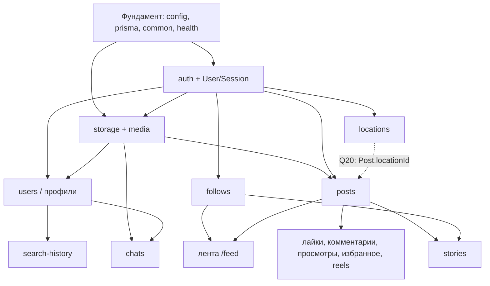

# План реализации и распределение работы

> Статус: 📝 предложено. Имена ролей — **Студент A** и **Студент B**; кто есть кто — решаете вы (Q26).
> Реализация начинается только после одобрения этого плана. Текущее состояние задач — в [STATUS.md](STATUS.md).

## 1. Зависимости модулей

## 2. Распределение модулей

Принцип: **после общего фундамента каждый ведёт свои модули целиком (backend + frontend)**.
Так модули развиваются параллельно, а каждый студент понимает полный путь запроса.
Чтобы оба могли объяснить всё приложение, каждый PR ревьюит второй студент.

| Модуль | Владелец | Почему так |
|---|---|---|
| Фундамент backend (`apps/api` каркас, config, prisma, common, Swagger) | **A** | один владелец общей инфраструктуры backend |
| Фундамент frontend (`apps/web` каркас, shadcn/ui, `lib/api`, providers, оболочка) | **B** | один владелец общей инфраструктуры frontend |
| Корневые конфигурации, CI | **A** (ревью B) | |
| `auth` backend (сессии, guard, пароли) | **A** | критический путь; первый за фундаментом backend |
| страницы `(auth)` и оболочка `(main)` | **B** | единственное исключение из «модуль целиком»: в Phase 1 B делает UI входа параллельно с backend A по согласованному контракту |
| `storage` + `media` | **B** | нужен постам и сторис (модули B); первый backend-модуль B |
| `users` / профили / поиск пользователей | **A** | продолжение auth |
| `follows` | **A** | связан с профилем |
| `search-history` | **A** | связан с поиском пользователей |
| `locations` | **A** | независимый, небольшой |
| `chats` | **A** | зависит от users и media |
| `posts`, лента, «Интересное», reels | **B** | основной контент |
| лайки, комментарии, просмотры, избранное | **B** | внутри модуля posts |
| `stories` | **B** | зависит от posts и media |
| `notifications` (если одобрено, Q21) | решается в Phase 6 | |

Нагрузка: у A больше модулей, у B — более объёмный UI (лента, создание постов, сторис). При заметном
перекосе модуль передаётся между фазами — по договорённости и с записью в этом документе.

## 3. Задачи по фазам

Каждая задача имеет ID `T<фаза>.<номер>`. Этот документ — **неизменный план** (что и в каком порядке);
текущее состояние задач (не начата / в работе / готова, ветка, PR) ведётся только в [STATUS.md](STATUS.md).
Ветки: `<тип>/<модуль>-<кратко>` (см. [CONTRIBUTING.md](../CONTRIBUTING.md#ветки)).
«Готово, когда» — минимальное условие закрытия задачи; полный список — критерии приёмки в спецификации функции
и [Definition of Done](development/AGENT_PLAYBOOKS.md#definition-of-done).

### Phase 0 — Фундамент

| ID | Задача | Кто | Зависит от | Готово, когда |
|---|---|---|---|---|
| T0.1 | Корень: Prettier, `concurrently`, общие правила форматирования | A | — | `npm install` в корне проходит; `npx prettier --check .` работает |
| T0.2 | Каркас NestJS: структура, ESLint (включая правила границ из ADR 0008), Jest, env-валидация, Prisma + подключение, префикс, `ValidationPipe`, фильтр ошибок, `helmet`, проверка `Origin`, Swagger, `GET /health`, скрипт `openapi:export` | A | T0.1 | `npm run dev:api` → `GET /api/v1/health` = 200; lint/typecheck/test зелёные |
| T0.3 | Каркас Next.js: Tailwind, shadcn/ui init, ESLint (правила границ), Vitest, rewrites, `lib/api/*` (base-api, types, errors, server), store + `StoreProvider` (RTK Query), Toaster, страница статуса `/health` | B | T0.1 | `npm run dev:web` открывает страницу; lint/typecheck/test зелёные |
| T0.4 | Скрипт `api:types`, корневой `npm run contract`, проверка прокси (cookie, Origin, multipart 100 МБ) → обновить ADR 0004 | A + B | T0.2, T0.3 | страница web показывает `/health` **через прокси**; результат проверки записан в ADR 0004 |
| T0.5 | GitHub Actions: `npm ci`, lint, typecheck, test, проверка контракта; защита ветки `main` | A | T0.4 | PR с изменённым DTO без `npm run contract` падает в CI |
| T0.6 | Harness: скрипт проверки ссылок документации в CI; `.claude/settings.json` (запрет чтения `.env`, запрет правки сгенерированных файлов); актуализация команд в AGENTS.md | A (ревью B) | T0.5 | битая ссылка в docs роняет CI; агент не может прочитать `.env` |

T0.2 и T0.3 выполняются **параллельно** и не пересекаются по файлам (кроме корневого `package-lock.json` — см. CONTRIBUTING).

### Phase 1 — Аутентификация, сессии, медиа-основа

| ID | Задача | Кто | Зависит от | Готово, когда |
|---|---|---|---|---|
| T1.1 | Prisma: `User`, `Session`, `PasswordResetToken` — **первая миграция** | A | Phase 0 | миграция в `main`; модель совпадает с DATA_MODEL.md |
| T1.2 | Модуль `auth`: регистрация, вход, выход, `SessionGuard`, `@CurrentUser`, `@Public`, смена и сброс пароля (`MAIL_DRIVER=log`), throttler | A | T1.1 | критерии приёмки [auth.md](features/auth.md#критерии-приёмки) (backend) + e2e-тесты |
| T1.3 | Prisma: `MediaFile` (после T1.1); `StorageService` (local), проверка файлов, `GET /media/{id}` | B | T1.1 | загрузка тестового файла сохраняется и отдаётся только вошедшему; тесты |
| T1.4 | Оболочка `(main)`: layout с `GET /me`, навигация, `proxy.ts`; страницы `(auth)` | B | T1.2 (контракт — из PR до влития) | гость попадает на `/login`; вход/выход/сброс работают через UI |
| T1.5 | Seed тестовых пользователей | A | T1.2 | `npm run prisma:seed -w api` создаёт пользователей; пароли только в seed-файле |

Интеграционная точка: совместная проверка входа через UI до закрытия фазы.

### Phase 2 — Профили, подписки, посты

| ID | Задача | Кто | Зависит от | Готово, когда |
|---|---|---|---|---|
| T2.1 | `users`: `/me`, `PATCH /me`, аватар, `GET /users`, `GET /users/{id}`, `DELETE /me` + страницы профиля и настроек | A | T1.2, T1.3 | критерии [users-and-profiles.md](features/users-and-profiles.md#критерии-приёмки) |
| T2.2 | `follows`: модель, endpoint'ы, кнопка подписки, списки | A | T2.1 | критерии [follows.md](features/follows.md#критерии-приёмки) |
| T2.3 | `posts`: модели `Post`, `PostMedia`; создание, просмотр, удаление, `GET /posts`, `GET /users/{id}/posts` + страницы | B | T1.3 | критерии [posts.md](features/posts.md#критерии-приёмки) (кроме ленты и reels) |
| T2.4 | `GET /feed` и главная страница | B | T2.2, T2.3 | лента показывает только подписки и свои посты |

### Phase 3 — Взаимодействия, reels, история поиска (параллельно с 4 и 5)

| ID | Задача | Кто | Зависит от | Готово, когда |
|---|---|---|---|---|
| T3.1 | `search-history` + страница поиска с историей | A | T2.1 | критерии [search-history.md](features/search-history.md#критерии-приёмки) |
| T3.2 | Лайки и избранное постов, страница `/saved` | B | T2.3 | критерии [post-interactions.md](features/post-interactions.md#критерии-приёмки) (лайки, избранное) |
| T3.3 | Комментарии | B | T2.3 | то же (комментарии) |
| T3.4 | Просмотры постов | B | T2.3 | то же (просмотры) |
| T3.5 | Reels (видео) | B | T2.3, Q10 | раздел reels в [posts.md](features/posts.md#критерии-приёмки) |

### Phase 4 — Stories и локации

| ID | Задача | Кто | Зависит от | Готово, когда |
|---|---|---|---|---|
| T4.1 | `locations` (+ `Post.locationId` по Q20 — согласовать с B) | A | T1.2, Q6, Q20 | критерии [locations.md](features/locations.md#критерии-приёмки) |
| T4.2 | `stories`: публикация, лента, просмотр, зрители, лайки | B | T2.2, T2.3 | критерии [stories.md](features/stories.md#критерии-приёмки) |

### Phase 5 — Чат

| ID | Задача | Кто | Зависит от | Готово, когда |
|---|---|---|---|---|
| T5.1 | `chats`: backend + UI, polling | A | T2.1, T1.3 | критерии [chat.md](features/chat.md#критерии-приёмки) |
| T5.2 | Playwright: 3–5 сквозных сценариев | B | T3.x, T4.2 | сценарии из [TESTING.md](development/TESTING.md) зелёные в CI |
| T5.3 | Доработка UI, удаление EXIF (Q25) | B | T2.3 | EXIF отсутствует в сохранённых фото |

### Phase 6–7

Задачи формируются после ответов на Q21, Q23, Q24, Q25 и добавляются сюда с ID `T6.x`, `T7.x`.

## 4. Правила интеграции

- Владелец модуля первым описывает изменения контракта в `API_CONTRACT.md` (в своём PR или отдельном небольшом PR),
  чтобы второй разработчик мог начать UI или зависимый модуль по согласованному контракту.
- Изменения `schema.prisma` — по очереди, по процессу [CHANGE_PROCESS.md](development/CHANGE_PROCESS.md).
- Раз в неделю — короткая синхронизация: что влито, что блокирует, какие вопросы Q закрыты.
- В конце каждой фазы — совместная проверка критериев приёмки из [ROADMAP.md](ROADMAP.md).
