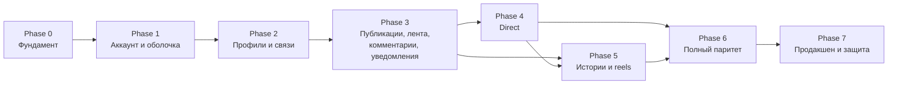

# Дорожная карта

> Статус: ✅ обновлено 2026-10-21 под паритет с Instagram ([ADR 0011](decisions/0011-instagram-parity-scope.md)).
> Фазы идут по зависимостям; внутри фазы — сначала P0, затем P1. **Документирование фазы не означает начало её
> реализации** — каждая фаза начинается после одобрения командой. Задачи — в [IMPLEMENTATION_PLAN.md](IMPLEMENTATION_PLAN.md).

## Phase −1 — Инициализация (текущая)
- **Результат:** документация, каталог функций, дизайн-система, контракт, модель данных, ADR, агенты.
- **Критерий:** команда одобрила документы; распределены задачи A/B (Q26). ✅ Выполнено 2026-10-22.

## Phase 0 — Фундамент
- **Результат:** каркасы `apps/api` и `apps/web`; ESLint (с правилами границ), Prettier, тесты; env-валидация, Prisma,
  префикс, фильтр ошибок, проверка `Origin`, helmet, Swagger, `/health`; токены дизайна (светлая/тёмная) в `globals.css`;
  `lib/api`, store; `npm run contract`; Socket.IO с аутентификацией по cookie; CI; проверки harness.
- **Критерии приёмки:** `npm install && npm run dev` по LOCAL_SETUP.md; страница показывает `/health` **через прокси**;
  проверены `Set-Cookie`, `Origin`, `multipart` 650 МБ через rewrite (ADR 0004) и подключение сокета с cookie (ADR 0013);
  изменённый DTO без `npm run contract` роняет CI; бизнес-функций нет.

## Phase 1 — Аккаунт и оболочка (P0)
- **Результат:** регистрация с кодом, вход по имени/email, выход, сброс и смена пароля, сессии; `POST /media` с sharp;
  страницы входа и регистрации; оболочка (меню 72/238, мобильная навигация, тема, заставка, «Ещё»); seed.
- **Критерии:** [auth.md](features/auth.md#критерии-приёмки) (кроме соцвхода и удаления); экраны 3.1–3.2 и оболочка совпадают с SCREENS.md.

## Phase 2 — Профили и связи (P0)
- **Результат:** профиль и редактирование, аватар, ссылки, имя пользователя; подписки и запросы; закрытый аккаунт и
  блокировка (`VisibilityService`); поиск аккаунтов и история поиска.
- **Критерии:** [users-and-profiles.md](features/users-and-profiles.md#критерии-приёмки), [follows.md](features/follows.md#критерии-приёмки),
  блокировка и закрытый аккаунт из [privacy-and-safety.md](features/privacy-and-safety.md#критерии-приёмки), поиск из
  [search-and-explore.md](features/search-and-explore.md#критерии-приёмки).

## Phase 3 — Публикации, лента, комментарии, уведомления (P0)
- **Результат:** создание каруселей с фото и видео (ffmpeg), лента, карточка и окно поста, сетка профиля, лайки,
  комментарии с ответами, сохранение, хэштеги и упоминания, уведомления в реальном времени, «Интересное», лента Reels.
- **Критерии:** [posts.md](features/posts.md#критерии-приёмки), [post-interactions.md](features/post-interactions.md#критерии-приёмки),
  [hashtags-and-mentions.md](features/hashtags-and-mentions.md#критерии-приёмки), [notifications.md](features/notifications.md#критерии-приёмки) — в части P0.

## Phase 4 — Direct (P0/P1)
- **Результат:** личные и групповые чаты в реальном времени, медиа, голосовые, реакции, ответы, редактирование, отмена,
  прочитано, печатает, присутствие, запросы, «поделиться».
- **Критерии:** [chat.md](features/chat.md#критерии-приёмки).

## Phase 5 — Истории и reels (P0/P1)
- **Результат:** истории (создание с редактором, просмотр, зрители, лайки, ответы и реакции в Direct, архив), стикеры,
  актуальное, полноценные reels.
- **Критерии:** [stories.md](features/stories.md#критерии-приёмки), раздел reels в [posts.md](features/posts.md#критерии-приёмки).

## Phase 6 — Полный паритет (P1, затем P2)
- **Результат:** соцвход Google/Facebook, звонки 1:1, ограничение/скрытие/близкие друзья/избранное, редактирование и архив
  публикаций, закрепления, подборки, все настройки и язык, места, жалобы и админ-панель; затем P2 из каталога.
- **Критерии:** соответствующие разделы спецификаций; каталог функций — все P1 ✅.

## Phase 7 — Продакшен и защита
- **Результат:** сквозные сценарии Playwright, итоговая дизайн-сверка, R2/S3, почта, TURN, деплой с HTTPS и `__Host-sid`,
  демо-данные, сценарий демонстрации.
- **Критерии:** все тесты зелёные; дизайн-сверка без открытых отклонений; документы соответствуют коду;
  [QUALITY_CHECKLIST.md](QUALITY_CHECKLIST.md) пройден; каждый студент объясняет любой модуль.
