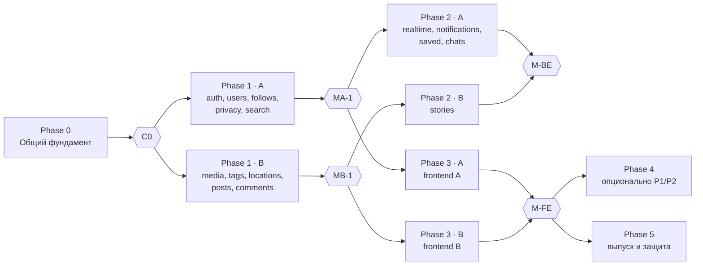

# Дорожная карта

> Статус: ✅ обновлено 2026-10-22 — backend-first, два независимых потока ([IMPLEMENTATION_PLAN.md](IMPLEMENTATION_PLAN.md)).
> **Документирование фазы не означает начало её реализации.** Задачи и владельцы — в плане, состояние — в [STATUS.md](STATUS.md).

Phases 2 и 3 у каждого студента могут чередоваться: frontend своих модулей начинается на своей точке (MA-1 / MB-1)
и **не ждёт** завершения чужого backend.

## Phase −1 — Инициализация ✅
Документация, каталог функций, дизайн-система, контракт, модель данных, ADR, агенты, истории; распределение задач.

## Phase 0 — Общий фундамент (A: T0.1–T0.3, T0.6 · B: T0.4, T0.5, T0.7)
- **Результат:** каркасы `apps/api` и `apps/web`, Prisma 7 с многофайловой схемой, общие механизмы, контракты и заглушки
  общих сервисов, дизайн-токены, оболочка, `npm run contract`, CI с обязательным ревью.
- **Критерии (C0):** `npm install && npm run dev` по LOCAL_SETUP.md; `/api/v1/health` через прокси; проверены cookie,
  `Origin`, большие `multipart` через rewrite; B пишет e2e-тест с `loginAs()`; изменённый DTO без `contract` роняет CI.

## Phase 1 — Независимый backend
- **A:** `auth`, страницы входа, `users` + `settings`, `follows`, `privacy` (`VisibilityService`), `search`.
- **B:** `media` + `storage`, `tags`, `locations`, `posts` (лента, «Интересное», reels, лайки, воспроизведения), `comments`.
- **Критерии:** MA-1 и MB-1 из [плана §3](IMPLEMENTATION_PLAN.md#3-зависимости-и-контрольные-точки); все операции R этих модулей.

## Phase 2 — Зависимый backend
- **A:** `realtime` (Socket.IO), `notifications`, сохранение, `chats`. **B:** `stories` + актуальное, ответы на истории → Direct.
- **Критерии (M-BE):** [план §6](IMPLEMENTATION_PLAN.md#6-backend-завершён-m-be) — все 57 операций и P0 backend,
  Swagger = код, воспроизводимые миграции, e2e критических сценариев.

## Phase 3 — Frontend своих модулей
- **A:** профиль, настройки, подписки, блокировка, поиск, уведомления, «Сохранённое», Direct.
- **B:** лента, карточка и окно поста, создание публикации, «Интересное», хэштеги, места, Reels, комментарии, истории.
- **Критерии (M-FE):** экраны по [SCREENS.md](design/SCREENS.md) в обеих темах; критерии UI в спецификациях.

## Phase 4 — Опционально (P1/P2)
Соцвход, звонки, ограничение и скрытие, подборки, Direct P1/P2 (A); правка/архив/закрепление публикаций, комментарии P1,
стикеры, админ-панель, фильтры (B). **Не блокирует** M-BE и M-FE.

## Phase 5 — Выпуск и защита
Дизайн-сверка своих экранов, Playwright, драйвер `s3`, почта, TURN, деплой (по Q23–Q25, Q34), подготовка к защите —
каждый объясняет и модули второго.
