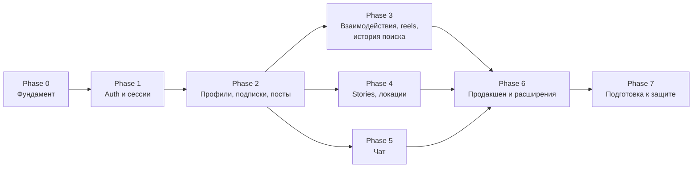

# Дорожная карта

> Фазы идут по зависимостям. **Документирование фазы не означает начало её реализации** —
> каждая фаза начинается после одобрения командой. Распределение задач — в [IMPLEMENTATION_PLAN.md](IMPLEMENTATION_PLAN.md).

Phases 3, 4 и 5 зависят только от Phase 2 и могут идти параллельно у разных разработчиков.

## Phase −1 — Инициализация ✅ (текущая)

- **Результат:** документация, контракт, минимальная структура каталогов.
- **Критерий:** команда одобрила документы; открытые вопросы с пометкой «Phase 0» закрыты.

## Phase 0 — Фундамент

- **Зависит от:** одобрения документации; Q26.
- **Результат:**
  - каркасы `apps/api` (NestJS) и `apps/web` (Next.js + Tailwind + shadcn/ui), установленные зависимости, lockfile;
  - ESLint, Prettier, `typecheck`, тестовые раннеры в обоих приложениях;
  - backend: валидация env, Prisma подключён к БД, глобальный префикс, `ValidationPipe`, фильтр ошибок, проверка `Origin`, `helmet`, Swagger, `GET /health`;
  - frontend: rewrite `/api/*`, `lib/api` (`baseApi` RTK Query, `serverFetch`, ошибки), store + `StoreProvider`, страница-заглушка, вызывающая `/health`;
  - `npm run contract` работает; CI в GitHub Actions: lint, typecheck, test, проверка контракта.
- **Критерии приёмки:**
  - `npm install && npm run dev` на чистой машине по LOCAL_SETUP.md запускает оба приложения;
  - страница web показывает статус `/api/v1/health`, полученный **через прокси**;
  - проверено, что через rewrite проходят `Set-Cookie`, `Origin` и `multipart` 100 МБ (результат записан в ADR 0004);
  - изменённый DTO без `npm run contract` роняет CI;
  - бизнес-функций нет.

## Phase 1 — Аутентификация и сессии

- **Зависит от:** Phase 0; Q2, Q3, Q4.
- **Результат:** модели `User`, `Session`, `PasswordResetToken`, `MediaFile`; модуль `auth`; `SessionGuard`; rate limiting;
  `StorageService` (драйвер `local`) и `GET /media/{id}`; страницы входа, регистрации, восстановления пароля;
  оболочка приложения `(main)` с проверкой сессии; seed с тестовыми пользователями.
- **Критерии приёмки:** все сценарии из [features/auth.md](features/auth.md#критерии-приёмки); e2e-тесты входа/выхода/сброса;
  запрос с чужим `Origin` → 403; 6-я неудачная попытка входа за минуту → 429.

## Phase 2 — Профили, подписки, посты

- **Зависит от:** Phase 1; Q5, Q7, Q8, Q9, Q25 (EXIF), Q28; утверждено визуальное направление UI.
- **Результат:** `/me`, профили, аватар, поиск пользователей, удаление аккаунта; подписки и списки;
  создание/просмотр/удаление постов с изображениями; лента подписок; «Интересное»; посты пользователя.
- **Критерии приёмки:** критерии из [users-and-profiles.md](features/users-and-profiles.md), [follows.md](features/follows.md), [posts.md](features/posts.md).

## Phase 3 — Взаимодействия с постами, reels, история поиска

- **Зависит от:** Phase 2; Q10, Q13, Q14, Q15.
- **Результат:** лайки, комментарии, просмотры, избранное (+ страница «Сохранённое»); reels (видео); история поиска.
- **Критерии приёмки:** [post-interactions.md](features/post-interactions.md), раздел reels в [posts.md](features/posts.md), [search-history.md](features/search-history.md).

## Phase 4 — Stories и локации

- **Зависит от:** Phase 2; Q6, Q11, Q12, Q20.
- **Результат:** публикация, лента, просмотр, лайки, зрители сторис; справочник локаций (и привязка к постам — по Q20).
- **Критерии приёмки:** [stories.md](features/stories.md), [locations.md](features/locations.md).

## Phase 5 — Чат

- **Зависит от:** Phase 2 (пользователи, медиа); Q16–Q19, Q29.
- **Результат:** чаты 1:1, сообщения с вложениями, удаление; обновление через polling.
- **Критерии приёмки:** [chat.md](features/chat.md).

## Phase 6 — Продакшен и расширения

- **Зависит от:** Phases 3–5; Q21, Q23, Q24, Q25.
- **Результат (по одобрению каждого пункта):** драйвер `s3` (R2/S3), отправка писем, деплой с HTTPS и cookie `__Host-sid`;
  при одобрении — Socket.IO для чата, уведомления, Redis/BullMQ (с ADR на каждое).
- **Критерии приёмки:** приложение доступно по HTTPS; секреты только в среде развёртывания; чек-лист безопасности пройден.

## Phase 7 — Подготовка к защите

- **Результат:** демо-данные, актуальная документация, сценарий демонстрации, каждый студент может объяснить любой модуль.
- **Критерии приёмки:** все тесты зелёные; документы не противоречат коду; пройден [QUALITY_CHECKLIST.md](QUALITY_CHECKLIST.md) целиком.
