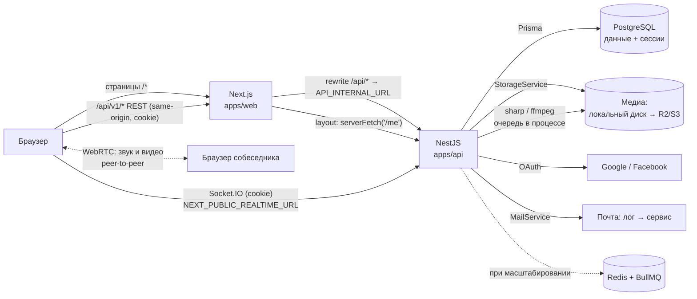

# Архитектура системы

> Статус: ✅ согласовано (обновлено 2026-10-21 под паритет с Instagram, ADR 0011–0017). Детали — в связанных документах.

## 1. Обзор

Модульный монолит из двух приложений в одном репозитории:

- **`apps/web`** — Next.js (App Router). Интерфейс «как Instagram» ([design/](../design/DESIGN_SYSTEM.md)). Бизнес-логики и доступа к БД нет.
- **`apps/api`** — NestJS. Единственное место бизнес-правил, прав и приватности, доступа к PostgreSQL, файлам и событиям.

Пунктир к Redis/BullMQ — будущая инфраструктура (раздел 6).

## 2. Потоки

1. **Страница.** Next.js отдаёт layout; layout `(main)` проверяет сессию через `serverFetch('/me')` (401 → `/accounts/login/`).
   Данные страницы загружает RTK Query в Client Component ([RENDERING_STRATEGY.md](RENDERING_STRATEGY.md)).
2. **Чтение и изменение.** RTK Query → `fetch('/api/v1/...')` на том же origin → rewrite → NestJS:
   guard сессии → проверка `Origin` → валидация DTO → controller → service (права, приватность, Prisma, транзакция) →
   ответ или ошибка единого формата.
3. **События.** После успешной транзакции сервис вызывает `RealtimeService.emitToUsers(...)` → Socket.IO доставляет
   событие во все вкладки получателей → frontend обновляет кэш RTK Query ([REALTIME.md](../api/REALTIME.md)).
4. **Медиа.** `POST /media` → проверка и сохранение → задача обработки (sharp/ffmpeg) → `READY` → событие
   `media:processed` → файл привязывается к посту, истории, сообщению.
5. **Звонок.** REST создаёт `Call` → Socket.IO передаёт сигналы WebRTC → звук и видео идут напрямую между браузерами.

## 3. Backend (NestJS)

### 3.1 Слои внутри модуля

| Слой | Отвечает за | Не делает |
|---|---|---|
| `*.controller.ts` | маршруты, DTO, Swagger-декораторы, текущий пользователь | бизнес-правила, Prisma |
| `*.service.ts` | бизнес-правила, права, приватность, Prisma, транзакции, вызов уведомлений и событий | работа с HTTP |
| `*.gateway.ts` (только `realtime`, `calls`) | события Socket.IO от клиента | бизнес-правила (вызывает сервис) |
| `dto/*.dto.ts` | форма запросов и ответов, валидация, Swagger | логика |

PrismaService используется прямо в сервисах; слоя репозиториев нет.

### 3.2 Модули

| Модуль | Ответственность | Зависит от |
|---|---|---|
| `config` | чтение и валидация env | — |
| `prisma` | PrismaService | config |
| `common` | фильтр ошибок, `SessionGuard`, `@Public()`, `@CurrentUser()`, проверка `Origin`, курсорная пагинация, разбор `#`/`@` | prisma |
| `storage` | `StorageService`: драйверы `local`, `s3` | config |
| `mail` | `MailService`: драйверы `log`, SMTP/сервис (Q23) | config |
| `realtime` | Socket.IO-шлюз, аутентификация сокета, `RealtimeService.emitToUsers`, присутствие | prisma, common |
| `health` | `GET /health` | prisma |
| `auth` | регистрация с кодом, вход, соцвход, сессии, пароли, 2FA (P2) | prisma, common, mail |
| `users` | `/me`, профили, имя пользователя, email, аватар, ссылки, удаление | prisma, media, follows, privacy |
| `settings` | настройки, тема, язык, настройки уведомлений | prisma |
| `privacy` | блок, ограничение, скрытие, «скрыть историю от»; **`VisibilityService`** — единая проверка «может ли A видеть B/контент B» | prisma, follows |
| `follows` | подписки, запросы, близкие друзья, избранное, рекомендации | prisma, notifications |
| `media` | `POST /media`, раздача с проверкой доступа, обработка (sharp, ffmpeg), очередь | storage, prisma, realtime |
| `tags` | хэштеги, страницы хэштегов, разбор упоминаний | prisma |
| `posts` | публикации, reels, ленты, «Интересное», лайки, воспроизведения, архив, закрепление | prisma, media, privacy, tags, notifications |
| `comments` | комментарии, ответы, лайки, закрепление, одобрение | prisma, privacy, tags, notifications |
| `collections` | сохранённое и подборки | prisma, privacy |
| `stories` | истории, стикеры, просмотры, лайки, ответы, архив, актуальное | prisma, media, privacy, chats, notifications |
| `chats` | переписки, группы, сообщения, реакции, прочитано, запросы, «поделиться» | prisma, media, privacy, realtime |
| `calls` | звонки, ICE-серверы, сигнализация | prisma, chats, realtime |
| `notifications` | создание (с учётом настроек и приватности), группировка, значки | prisma, settings, privacy, realtime |
| `search` | поиск, подсказки, история поиска | prisma, privacy |
| `locations` | справочник мест, страницы мест | prisma, privacy |
| `admin` | жалобы, модерация, галочки, баны | prisma, auth |

Правила зависимостей: модули верхнего уровня не зависят друг от друга по кругу; `privacy`, `notifications`,
`realtime`, `media`, `tags` — «нижний» слой, их используют функциональные модули. Если две функции нужны друг
другу — общая часть уходит в нижний слой.

### 3.3 Сквозные механизмы

| Механизм | Решение |
|---|---|
| Префикс | `app.setGlobalPrefix('api/v1')` |
| Валидация | глобальный `ValidationPipe({ whitelist: true, forbidNonWhitelisted: true, transform: true })` |
| Ошибки | глобальный exception filter → [формат](../api/API_CONTRACT.md#12-формат-ошибки-) |
| Аутентификация | глобальный `SessionGuard`; публичные маршруты — `@Public()`; сокеты — проверка cookie при рукопожатии |
| Авторизация и приватность | явные проверки в сервисах + `VisibilityService` для всех выдач (блокировки, закрытые аккаунты, аудитория историй) |
| CSRF | проверка `Origin` для изменяющих методов и сокетов |
| Rate limiting | `@nestjs/throttler` (в памяти; Redis — при масштабировании) |
| События | `RealtimeService.emitToUsers(userIds, event, payload)` после транзакции |
| Уведомления | `NotificationsService.create(...)` после транзакции |
| Фоновые задачи | очередь в процессе (`media`), позже BullMQ (ADR 0016) |
| Swagger | `@nestjs/swagger` + CLI-плагин; экспорт в `docs/api/openapi.json` |
| Логи | `Logger` NestJS; без паролей, токенов, cookie, текстов сообщений |

## 4. Frontend (Next.js)

| Часть | Ответственность |
|---|---|
| `app/` | маршруты как в Instagram ([SCREENS.md](../design/SCREENS.md#1-маршруты)), layout'ы, проверка сессии |
| `features/<name>/` | компоненты и эндпоинты RTK Query функции (`api.ts`) |
| `components/ui/` | компоненты shadcn/ui, настроенные под [DESIGN_SYSTEM.md](../design/DESIGN_SYSTEM.md) |
| `components/layout/` | оболочка: боковое меню, мобильная навигация, панели |
| `lib/api/` | `baseApi`, типы, ошибки, `serverFetch` |
| `lib/realtime.ts` | одно подключение Socket.IO; события → кэш RTK Query |
| `lib/webrtc.ts` | звонки: `RTCPeerConnection`, медиа-потоки |

Frontend **не дублирует** бизнес-правила и правила приватности: что показывать, решает backend.

## 5. Данные и медиа

- **PostgreSQL** хранит всё, включая сессии и метаданные файлов. Модель — [DATA_MODEL.md](../database/DATA_MODEL.md).
- **Файлы** — `apps/api/storage/` в разработке, R2/S3 позже (ADR 0007); обработка — sharp и ffmpeg (ADR 0016).
- Файлы отдаются через `GET /api/v1/media/{id}` с проверкой доступа к объекту, к которому привязан файл.

## 6. Инфраструктура: что сейчас и что позже

| Технология | Статус | Для чего |
|---|---|---|
| **Socket.IO** | ✅ используется (ADR 0013) | сообщения, «печатает», присутствие, уведомления, сигналы звонков |
| **WebRTC** | ✅ используется (ADR 0015) | звонки; STUN публичный, TURN — Q34 |
| **sharp, ffmpeg** | ✅ используется (ADR 0016) | обработка изображений, видео, голосовых |
| **Redis** | позже: несколько экземпляров backend или BullMQ | адаптер Socket.IO, throttler, очередь |
| **BullMQ** | позже, вместе с Redis (Q33) | замена очереди в процессе |
| **Docker** | позже (Q33) | Redis, MinIO, Mailpit локально; деплой |
| **Медиасервер (SFU)** | только для групповых звонков > 4 участников | отдельный ADR |

Каждое добавление инфраструктуры — отдельный ADR.

## 7. Связанные документы

- [product/FEATURE_CATALOG.md](../product/FEATURE_CATALOG.md) — что умеет продукт
- [design/DESIGN_SYSTEM.md](../design/DESIGN_SYSTEM.md), [design/SCREENS.md](../design/SCREENS.md) — как выглядит
- [MONOREPO_STRUCTURE.md](MONOREPO_STRUCTURE.md) — структура репозитория и скрипты
- [API_REQUEST_ARCHITECTURE.md](API_REQUEST_ARCHITECTURE.md) — как frontend общается с backend
- [AUTHENTICATION.md](AUTHENTICATION.md), [SECURITY.md](SECURITY.md) — сессии, соцвход, безопасность
- [RENDERING_STRATEGY.md](RENDERING_STRATEGY.md) — Server/Client Components
- [../api/REALTIME.md](../api/REALTIME.md) — события реального времени
- [../decisions/](../decisions/README.md) — архитектурные решения (ADR)
