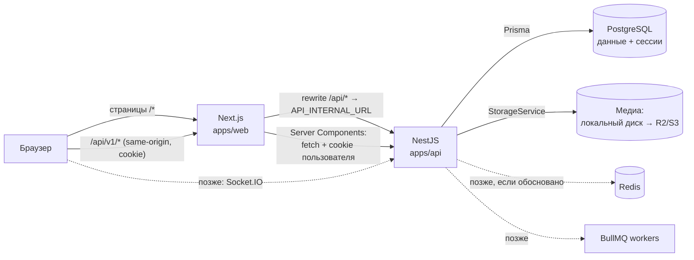

# Архитектура системы

> Статус: ✅ согласовано направление. Детали — в связанных документах.

## 1. Обзор

Модульный монолит из двух приложений в одном репозитории:

- **`apps/web`** — Next.js (App Router). Отвечает за интерфейс. Бизнес-логики и доступа к БД нет.
- **`apps/api`** — NestJS. Единственное место бизнес-правил, проверки прав, доступа к PostgreSQL и файлам.

Сплошные линии — то, что строится сейчас. Пунктир — будущая инфраструктура (раздел 6).

## 2. Поток запроса

1. Браузер открывает страницу. Next.js рендерит Server Component; тот запрашивает данные у NestJS
   напрямую по `API_INTERNAL_URL` и пересылает cookie пользователя.
2. Интерактивные действия (лайк, комментарий, отправка формы) выполняет Client Component:
   `fetch('/api/v1/...')` на том же origin. Next.js проксирует запрос в NestJS (rewrite).
3. NestJS: guard сессии → валидация DTO → controller → service (проверка прав + Prisma) → ответ
   или ошибка единого формата.

Подробно: [API_REQUEST_ARCHITECTURE.md](API_REQUEST_ARCHITECTURE.md), [RENDERING_STRATEGY.md](RENDERING_STRATEGY.md).

## 3. Backend (NestJS)

### 3.1 Слои внутри модуля

Три слоя — без отдельных «репозиториев» и «use case» классов:

| Слой | Отвечает за | Не делает |
|---|---|---|
| `*.controller.ts` | маршруты, DTO, Swagger-декораторы, получение текущего пользователя | бизнес-правила, Prisma |
| `*.service.ts` | бизнес-правила, проверка прав владения, запросы Prisma, транзакции | работа с HTTP (req/res) |
| `dto/*.dto.ts` | форма запросов и ответов, валидация (`class-validator`), описание для Swagger | логика |

PrismaService используется прямо в сервисах. Отдельный слой репозиториев не нужен: Prisma уже является
типизированным слоем доступа к данным, а лишняя обёртка усложнит объяснение кода.

### 3.2 Модули

| Модуль | Ответственность | Зависит от |
|---|---|---|
| `config` | чтение и валидация env при старте | — |
| `prisma` | PrismaService (подключение к БД) | config |
| `common` | фильтр ошибок, `SessionGuard`, декораторы `@Public()`, `@CurrentUser()`, проверка `Origin`, пагинация | prisma |
| `storage` | `StorageService`: сохранить/удалить/прочитать файл; драйверы `local`, `s3` | config |
| `health` | `GET /health` | prisma |
| `auth` | регистрация, вход/выход, сессии, сброс и смена пароля | prisma, common |
| `users` | `/me`, профили, аватар, поиск пользователей, удаление аккаунта | prisma, storage, follows (счётчики) |
| `follows` | подписки, списки подписчиков/подписок | prisma |
| `media` | `GET /media/{id}` с проверкой доступа; общая логика проверки загружаемых файлов | storage, prisma |
| `posts` | посты, reels, лента, лайки, комментарии, просмотры, избранное | prisma, media, follows (лента) |
| `stories` | сторис, просмотры, лайки, лента сторис | prisma, media, follows, posts (сторис из поста) |
| `chats` | чаты 1:1, сообщения, вложения | prisma, media |
| `search-history` | история текстового поиска и поиска пользователей | prisma |
| `locations` | справочник локаций | prisma |
| `notifications` | ❓ Q21 — не создаётся до согласования | — |

Лайки, комментарии, просмотры и избранное постов живут в модуле `posts`: это тесно связанные операции над
одним ресурсом, и отдельные модули дали бы только лишние зависимости. Если `posts` станет слишком большим,
его можно разделить на сервисы внутри модуля (`posts.service.ts`, `comments.service.ts`).

### 3.3 Сквозные механизмы

| Механизм | Решение |
|---|---|
| Префикс | `app.setGlobalPrefix('api/v1')` |
| Валидация | глобальный `ValidationPipe({ whitelist: true, forbidNonWhitelisted: true, transform: true })` |
| Ошибки | один глобальный exception filter → формат из [API_CONTRACT.md](../api/API_CONTRACT.md#12-формат-ошибки-) |
| Аутентификация | глобальный `SessionGuard`; публичные маршруты помечаются `@Public()` |
| Авторизация | явные проверки в сервисах (`if (post.authorId !== user.id) throw new ForbiddenException()`) |
| CSRF | глобальная проверка `Origin` для изменяющих методов |
| Rate limiting | `@nestjs/throttler` (в памяти процесса; Redis — позже) |
| Swagger | `@nestjs/swagger` + CLI-плагин; экспорт в `docs/api/openapi.json` |
| Логи | встроенный `Logger` NestJS; без паролей, токенов, cookie |

## 4. Frontend (Next.js)

| Часть | Ответственность |
|---|---|
| `app/` | маршруты, layout'ы, загрузка начальных данных в Server Components |
| `features/<name>/` | компоненты и хуки конкретной функции; `api.ts` — запросы этой функции |
| `components/ui/` | компоненты shadcn/ui (генерируются CLI, правятся минимально) |
| `components/layout/` | оболочка приложения: навигация, боковая панель |
| `lib/api/` | единственный API-клиент, сгенерированные типы, разбор ошибок |

Frontend **не дублирует** бизнес-правила: права, уникальность, лимиты проверяет backend.
Формы делают только проверки для удобства пользователя (обязательные поля, длина, совпадение паролей).

## 5. Данные и медиа

- **PostgreSQL** хранит всё, включая сессии и **метаданные** файлов (`MediaFile`).
- **Файлы** лежат в хранилище. В разработке — каталог `apps/api/storage/` (в `.gitignore`).
  Позже — Cloudflare R2 или Amazon S3 через тот же `StorageService` (драйвер `s3`, протокол S3 у обоих).
- Файлы отдаются через `GET /api/v1/media/{id}` с проверкой прав. С драйвером `s3` этот endpoint может
  отвечать редиректом на короткоживущую подписанную ссылку — интерфейс для frontend не меняется.

Подробно: [DATA_MODEL.md](../database/DATA_MODEL.md), [ADR 0007](../decisions/0007-media-storage.md).

## 6. Будущая инфраструктура: когда и зачем

Ничего из этого не добавляется «на всякий случай». Каждое добавление — отдельное решение (ADR).

| Технология | Добавляем, когда | Для чего |
|---|---|---|
| **Socket.IO** | одобрен real-time для чата (Q19) или уведомлений (Q21) | доставка новых сообщений без перезагрузки |
| **Redis** | появился Socket.IO на нескольких экземплярах, или rate limit/кэш нужно разделять между процессами | адаптер Socket.IO, хранилище throttler, кэш |
| **BullMQ** (требует Redis) | есть медленная работа, которую нельзя делать в запросе: отправка писем, обработка видео/изображений, массовая рассылка уведомлений | фоновые задачи с повторными попытками |
| **Docker** | нужен MinIO/Mailpit/Redis локально или подготовка к деплою | одинаковое окружение |

До этого момента: чат обновляется периодическим запросом (polling) RTK Query (`pollingInterval`), письма в разработке
пишутся в лог, истёкшие сторис отфильтровываются запросом (`expiresAt > now()`), а не фоновой задачей.

## 7. Связанные документы

- [MONOREPO_STRUCTURE.md](MONOREPO_STRUCTURE.md) — структура репозитория и скрипты
- [API_REQUEST_ARCHITECTURE.md](API_REQUEST_ARCHITECTURE.md) — как frontend общается с backend
- [AUTHENTICATION.md](AUTHENTICATION.md) — сессии и cookie
- [SECURITY.md](SECURITY.md) — меры безопасности
- [RENDERING_STRATEGY.md](RENDERING_STRATEGY.md) — Server/Client Components
- [../decisions/](../decisions/README.md) — архитектурные решения (ADR)
