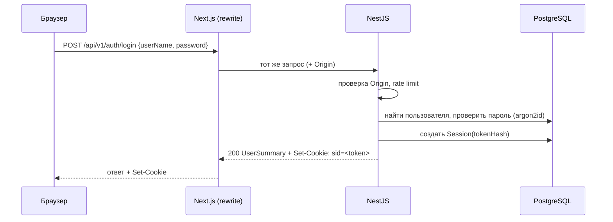

# Аутентификация и сессии

> Статус: ✅ направление согласовано (серверные сессии в PostgreSQL + HttpOnly cookie).
> Числовые параметры помечены 📝 — их можно уточнить без изменения архитектуры.

## 1. Модель

- Сессия хранится **на сервере** в таблице `Session` (PostgreSQL).
- Браузер получает только **случайный непрозрачный токен** в HttpOnly cookie.
- В БД хранится **SHA-256 хеш** токена, а не сам токен: утечка таблицы не даёт войти от чужого имени.
- JWT не используется: сессию в БД можно отозвать мгновенно (выход, смена пароля), и её проще объяснить.

```
Session
  id          UUID
  tokenHash   string, unique      ← sha256(token)
  userId      → User
  createdAt   datetime
  lastUsedAt  datetime
  expiresAt   datetime            ← скользящий срок (idle)
  absoluteExpiresAt datetime      ← жёсткий предел
  userAgent   string?             ← только для показа «активные сессии» (если понадобится)
```

## 2. Cookie

| Атрибут | Разработка | Продакшен | Зачем |
|---|---|---|---|
| Имя | `sid` | `__Host-sid` | префикс `__Host-` запрещает `Domain` и требует `Secure` и `Path=/` |
| `HttpOnly` | да | да | JavaScript не может прочитать токен (защита от кражи через XSS) |
| `Secure` | нет (http://localhost) | да | только HTTPS |
| `SameSite` | `Lax` | `Lax` | браузер не отправляет cookie в межсайтовых POST/fetch; переходы по ссылкам работают |
| `Path` | `/` | `/` | |
| `Max-Age` | = остаток idle-срока | = остаток idle-срока | |

Cookie ставит **только NestJS** (`Set-Cookie` в ответе), он проходит к браузеру через прокси Next.js.

## 3. Сроки 📝

| Параметр | Значение | env |
|---|---|---|
| Срок бездействия (idle) | 7 дней | `SESSION_IDLE_TTL_DAYS` |
| Абсолютный срок | 30 дней | `SESSION_ABSOLUTE_TTL_DAYS` |
| Продление | при запросе, не чаще 1 раза в час (чтобы не писать в БД на каждый запрос) | — |
| Токен сброса пароля | 30 минут, одноразовый | `PASSWORD_RESET_TTL_MINUTES` |

## 4. Сценарии

### Регистрация и вход



- При ошибке — `401 INVALID_CREDENTIALS` без уточнения, что неверно (логин или пароль).
- Если пользователь не найден, всё равно выполняется проверка хеша с фиктивным значением — время
  ответа не выдаёт, существует ли аккаунт.
- Регистрация создаёт пользователя и (по умолчанию, Q4) сразу сессию.

### Проверка сессии на каждом запросе

1. Глобальный `SessionGuard` читает cookie. Нет cookie и маршрут не `@Public()` → `401`.
2. `sha256(token)` → поиск `Session`; нет записи, истёк `expiresAt` или `absoluteExpiresAt` → удалить запись, `401`.
3. Если `lastUsedAt` старше часа — продлить `expiresAt` (не дальше `absoluteExpiresAt`) и обновить cookie.
4. `request.user = { id, role }` → доступен через `@CurrentUser()`.

### Выход

`POST /auth/logout` → удалить `Session` → `Set-Cookie` с `Max-Age=0` → `204`.

### Смена и сброс пароля

| Действие | Сессии |
|---|---|
| `POST /auth/password/change` (нужен текущий пароль) | все **остальные** сессии удаляются, текущая остаётся |
| `POST /auth/password/forgot` | создаётся `PasswordResetToken` (в БД — хеш), ссылка отправляется письмом; в разработке — пишется в лог (`MAIL_DRIVER=log`) |
| `POST /auth/password/reset` | токен проверяется и помечается использованным; **все** сессии удаляются |
| `DELETE /me` | пользователь и все его сессии удаляются |

### Ротация

Токен сессии всегда создаёт сервер при входе — подставить свой токен (session fixation) нельзя.
Отдельная периодическая ротация токена не нужна: короткий idle-срок и отзыв при смене пароля достаточны
для учебного проекта. Пересмотреть при подготовке к продакшену.

## 5. Next.js и сессия

| Где | Что делает | Чего не делает |
|---|---|---|
| `proxy.ts` (бывший middleware) | если cookie нет — редирект на `/login` для страниц `(main)`; если есть — пропускает | **не проверяет** сессию по-настоящему: это только удобство |
| layout `(main)` (Server Component) | `GET /me` с cookie пользователя; `401` → `redirect('/login')` | не хранит пользователя в глобальном store |
| Client Components | запросы через прокси; на `401` — переход на `/login` | не читают cookie |

Настоящая проверка — **всегда в NestJS**.

## 6. Пароли

- Алгоритм: **Argon2id** (библиотека `argon2`), параметры по рекомендациям OWASP (память ≥ 19 MiB, итерации ≥ 2).
- Длина пароля: 8–128 символов 📝; без требований к составу символов (рекомендация NIST), но с запретом
  совпадения с `userName`/`email`.
- Хеш никогда не попадает в ответы API: сервисы выбирают поля пользователя явно.

## 7. Роли

Поле `role` у пользователя: `USER` (по умолчанию) и `ADMIN` — ❓ Q6. Пока вопрос не решён, роль `ADMIN`
закладывается в схему, но административные endpoint'ы не реализуются.

## 8. Rate limiting чувствительных операций

См. [SECURITY.md](SECURITY.md#ограничение-частоты-запросов).
