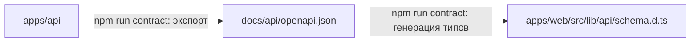

# Структура монорепозитория

> Статус: ✅ согласовано. npm workspaces ([ADR 0008](../decisions/0008-npm-workspaces.md)), без оркестратора сборки, без `packages/` на старте.

## 1. Дерево

```
instagram-social-network/
├── apps/
│   ├── web/                      # Next.js — см. apps/web/README.md
│   └── api/                      # NestJS + Prisma — см. apps/api/README.md
├── docs/
│   ├── product/                  # каталог функций (паритет с Instagram)
│   ├── design/                   # дизайн-система и экраны
│   ├── api/                      # исходный Swagger, inventory, наш контракт + endpoints/ по модулям, REALTIME, openapi.json (генерируется)
│   ├── architecture/
│   ├── database/
│   ├── features/
│   ├── development/
│   ├── decisions/                # ADR
│   ├── README.md                 # карта документации
│   ├── STATUS.md                 # текущее состояние и оглавление историй
│   ├── stories/                  # истории: журнал действий ГГГГ-ММ-ДД_ЧЧММ_<slug>.md
│   ├── GLOSSARY.md
│   ├── REQUIREMENTS.md
│   ├── ROADMAP.md
│   ├── IMPLEMENTATION_PLAN.md
│   └── QUALITY_CHECKLIST.md
├── infrastructure/
│   └── docker/                   # пока пусто (Docker не нужен на старте)
├── .github/
│   ├── pull_request_template.md  # CI workflow добавляется в Phase 0
│   └── CODEOWNERS                # ревью второго студента обязательно
├── .claude/
│   └── agents/                   # 8 субагентов Claude Code (docs/development/AI_AGENTS.md)
├── .editorconfig  .gitattributes  .gitignore  .nvmrc
├── package.json                  # workspaces + корневые скрипты
├── package-lock.json             # появится в Phase 0 (единственный lockfile)
├── README.md  CONTRIBUTING.md
├── AGENTS.md                     # точка входа для любого ИИ-агента
└── CLAUDE.md                     # подключает AGENTS.md для Claude Code
```

## 2. Почему так

| Решение | Причина |
|---|---|
| Два приложения в `apps/` | frontend и backend — независимые приложения со своими зависимостями, сборкой и env |
| **Нет `packages/`** | типы API генерируются из Swagger backend — общий пакет типов не нужен. Пакет появится, только когда один и тот же код реально понадобится обоим приложениям (новый ADR) |
| npm workspaces | npm уже установлен вместе с Node.js, не нужен отдельный инструмент ([ADR 0008](../decisions/0008-npm-workspaces.md)) |
| Нет Turborepo/Nx | два приложения; скриптов `npm run <script> -w <app>` достаточно |
| `.env.example` в каждом приложении | Next.js и NestJS читают env из своего каталога; один корневой файл путал бы, какая переменная кому нужна |
| Prisma внутри `apps/api` | БД — деталь реализации backend; frontend о ней не знает |
| `docs/api/openapi.json` в `docs/` | это контракт между приложениями: backend его генерирует, frontend читает. Ни одно приложение не импортирует код другого |

## 3. Правила зависимостей



- `apps/web` **не импортирует** файлы из `apps/api` и наоборот.
- Единственная связь — файл контракта `docs/api/openapi.json` (генерируется, вручную не правится).
- Зависимости объявляются в `package.json` того приложения, которое их использует. Корневой `package.json`
  содержит только workspaces, скрипты и общие dev-инструменты (Prettier, `concurrently` — в Phase 0).
- npm поднимает пакеты в общий `node_modules` в корне, поэтому импорт чужого пакета «случайно» сработает.
  Это запрещают правила ESLint (Phase 0): `import/no-extraneous-dependencies` (импорт только объявленных
  зависимостей) и `no-restricted-imports` (запрет импорта из соседнего приложения). См. [ADR 0008](../decisions/0008-npm-workspaces.md).

## 4. Скрипты

Корневые скрипты уже описаны в `package.json`; заработают после Phase 0, когда появятся приложения.

| Команда | Что делает |
|---|---|
| `npm run dev` | запускает web (порт 3000) и api (порт 4000) параллельно |
| `npm run dev:web` / `npm run dev:api` | запускает одно приложение |
| `npm run build` | собирает оба приложения |
| `npm run lint` / `npm run typecheck` / `npm run test` | проверки во всех приложениях |
| `npm run contract` | экспорт Swagger из api → `docs/api/openapi.json` → генерация `schema.d.ts` в web |

Скрипты внутри приложений (планируются): `dev`, `build`, `lint`, `typecheck`, `test`;
в api дополнительно `openapi:export`, `prisma:migrate`, `prisma:seed`, `test:e2e`; в web — `api:types`.

Имена workspace-пакетов — `api` и `web` (поле `name` в их `package.json`), поэтому работают команды вида:

| Задача | Команда |
|---|---|
| скрипт одного приложения | `npm run test:e2e -w api` |
| установить зависимость в приложение | `npm install zod -w web` |
| dev-зависимость в приложение | `npm install -D @types/multer -w api` |
| CLI-инструмент приложения | `npm exec -w api -- prisma migrate dev --name add_posts` |
| общий dev-инструмент в корень | `npm install -D prettier` (в корне, без `-w`) |

`npm run dev` использует пакет `concurrently` (корневая dev-зависимость, ставится в Phase 0): у npm нет
встроенного параллельного запуска, а `&` в скриптах не работает одинаково в Windows и Linux.

## 5. Версии

- **Node.js 24** (`.nvmrc`, `engines`). Установлен у разработчиков: 24.15.
- **npm 11** — идёт вместе с Node.js 24 (у разработчиков 11.12.1); отдельная установка не нужна.
- Версии библиотек фиксируются в `package-lock.json` при создании приложений (Phase 0); используется актуальная стабильная версия на тот момент.
- Lockfile один — в корне; в приложениях своих `package-lock.json` нет.
- В CI зависимости ставятся через `npm ci` (строго по lockfile).
