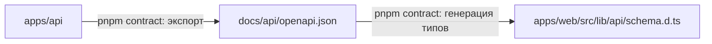

# Структура монорепозитория

> Статус: ✅ согласовано. pnpm workspaces, без оркестратора сборки, без `packages/` на старте.

## 1. Дерево

```
instagram-social-network/
├── apps/
│   ├── web/                      # Next.js — см. apps/web/README.md
│   └── api/                      # NestJS + Prisma — см. apps/api/README.md
├── docs/
│   ├── api/                      # исходный Swagger, inventory, наш контракт, openapi.json (генерируется)
│   ├── architecture/
│   ├── database/
│   ├── features/
│   ├── development/
│   ├── decisions/                # ADR
│   ├── REQUIREMENTS.md
│   ├── ROADMAP.md
│   ├── IMPLEMENTATION_PLAN.md
│   └── QUALITY_CHECKLIST.md
├── infrastructure/
│   └── docker/                   # пока пусто (Docker не нужен на старте)
├── .github/
│   └── pull_request_template.md  # CI workflow добавляется в Phase 0
├── .editorconfig  .gitattributes  .gitignore  .nvmrc
├── package.json                  # корневые скрипты
├── pnpm-workspace.yaml
├── README.md  CONTRIBUTING.md  CLAUDE.md
```

## 2. Почему так

| Решение | Причина |
|---|---|
| Два приложения в `apps/` | frontend и backend — независимые приложения со своими зависимостями, сборкой и env |
| **Нет `packages/`** | типы API генерируются из Swagger backend — общий пакет типов не нужен. Пакет появится, только когда один и тот же код реально понадобится обоим приложениям (новый ADR) |
| Нет Turborepo/Nx | два приложения; скриптов `pnpm --filter` достаточно |
| `.env.example` в каждом приложении | Next.js и NestJS читают env из своего каталога; один корневой файл путал бы, какая переменная кому нужна |
| Prisma внутри `apps/api` | БД — деталь реализации backend; frontend о ней не знает |
| `docs/api/openapi.json` в `docs/` | это контракт между приложениями: backend его генерирует, frontend читает. Ни одно приложение не импортирует код другого |

## 3. Правила зависимостей



- `apps/web` **не импортирует** файлы из `apps/api` и наоборот.
- Единственная связь — файл контракта `docs/api/openapi.json` (генерируется, вручную не правится).
- Зависимости объявляются в `package.json` того приложения, которое их использует. Корневой `package.json`
  содержит только скрипты (и, в Phase 0, общие dev-инструменты: Prettier).

## 4. Скрипты

Корневые скрипты уже описаны в `package.json`; заработают после Phase 0, когда появятся приложения.

| Команда | Что делает |
|---|---|
| `pnpm dev` | запускает web (порт 3000) и api (порт 4000) параллельно |
| `pnpm dev:web` / `pnpm dev:api` | запускает одно приложение |
| `pnpm build` | собирает оба приложения |
| `pnpm lint` / `pnpm typecheck` / `pnpm test` | проверки во всех приложениях |
| `pnpm contract` | экспорт Swagger из api → `docs/api/openapi.json` → генерация `schema.d.ts` в web |

Скрипты внутри приложений (планируются): `dev`, `build`, `lint`, `typecheck`, `test`;
в api дополнительно `openapi:export`, `prisma:migrate`, `prisma:seed`, `test:e2e`; в web — `api:types`.

## 5. Версии

- **Node.js 24** (`.nvmrc`, `engines`). Установлен у разработчиков: 24.15.
- **pnpm 12.8.2** (`packageManager`), включается через `corepack enable`.
- Версии библиотек фиксируются в `pnpm-lock.yaml` при создании приложений (Phase 0); используется актуальная стабильная версия на тот момент.
- pnpm по умолчанию не запускает install-скрипты зависимостей. Для пакетов, которым это нужно
  (Prisma, argon2, при необходимости sharp), разрешение добавляется явно в Phase 0.
