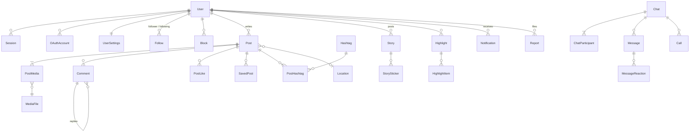

# Модель данных

> **Статус: 📝 кандидат** под каталог функций ([ADR 0011](../decisions/0011-instagram-parity-scope.md)). `schema.prisma` пишется
> по этой модели **по модулям в своих задачах**, а не целиком заранее. Поля с 📝 уточняются при реализации функции.
> Правила проектирования — [DATABASE_DECISIONS.md](DATABASE_DECISIONS.md).

## 1. Общие правила

- Первичные ключи — UUID ([решение](DATABASE_DECISIONS.md#идентификаторы)); у публикаций дополнительно `shortcode` (11 символов) для адресов `/p/…`.
- У каждой таблицы `createdAt`; у изменяемых — `updatedAt`.
- Отношения «пользователь ↔ объект» (лайк, сохранение, подписка, блок) — составной первичный ключ.
- Счётчики вычисляются (`_count`), кроме `Post.playCount` (воспроизведения — не уникальные записи).
- Каждая модель принадлежит **одному модулю**; модели модуля лежат в его файле схемы `apps/api/prisma/schema/<module>.prisma`
  ([ADR 0018](../decisions/0018-parallel-backend-workstreams.md)); меняет их только владелец, по CHANGE_PROCESS.md.

| Файл схемы | Модели | Владелец | Задача |
|---|---|---|---|
| `base.prisma` | generator, datasource | A | T0.2 |
| `account.prisma` | `User` (+ поля профиля), `Session`, `UserSettings` | A | T0.3, T1.A3 |
| `auth.prisma` | `EmailVerificationCode`, `PasswordResetToken`, `UsernameChange`, `OAuthAccount`, `TwoFactorSecret` | A | T1.A1, T4.A1, T4.A4 |
| `users.prisma` | `UserLink` | A | T1.A3 |
| `settings.prisma` | `NotificationPreference` | A | T1.A3 |
| `follows.prisma` | `Follow`, `CloseFriend`, `FavoriteAccount` | A | T1.A4, T4.A3 |
| `privacy.prisma` | `Block`, `Restrict`, `Mute`, `StoryHiddenFrom`, `HiddenWord` | A | T1.A5, T4.A3 |
| `search.prisma` | `SearchHistoryEntry` | A | T1.A6 |
| `collections.prisma` | `SavedPost`, `Collection`, `CollectionItem` | A | T2.A3, T4.A5 |
| `notifications.prisma` | `Notification` | A | T2.A2 |
| `chats.prisma` | `Chat`, `ChatParticipant`, `Message`, `MessageMedia`, `MessageReaction`, `Note` | A | T2.A4 |
| `calls.prisma` | `Call`, `CallParticipant` | A | T4.A2 |
| `media.prisma` | `MediaFile` | B | T1.B1 |
| `tags.prisma` | `Hashtag`, `PostHashtag`, `PostMention`, `CommentMention` | B | T1.B2, T1.B5 |
| `locations.prisma` | `Location` | B | T1.B3 |
| `posts.prisma` | `Post`, `PostMedia`, `PostUserTag`, `PostCollaborator`, `PostLike`, `PostPlay` | B | T1.B4, T4.B1 |
| `comments.prisma` | `Comment`, `CommentLike` | B | T1.B5 |
| `stories.prisma` | `Story`, `StorySticker`, `StoryStickerResponse`, `StoryView`, `StoryLike`, `Highlight`, `HighlightItem` | B | T2.B1, T4.B3 |
| `admin.prisma` | `Report` | B | T4.B4 |
- Перечисления (enum) — в верхнем регистре: `ACCEPTED`, `PENDING`.

## 2. Обзор

## 3. Сущности по модулям

### Аккаунт (`auth`)

| Модель | Поля | Ограничения, заметки | Функции |
|---|---|---|---|
| `User` | `id`, `userName`, `email`, `emailVerifiedAt?`, `passwordHash?`, `fullName`, `birthday`, `role` (`USER`/`ADMIN`), `isVerified`, `status` (`ACTIVE`/`DEACTIVATED`/`PENDING_DELETION`/`BANNED`), `deletionScheduledAt?`, профиль (ниже), `createdAt`, `updatedAt` | `userName`, `email` уникальны, в нижнем регистре; `passwordHash` пуст у аккаунтов только с соцвходом | F-ACC-* |
| `Session` | `id`, `tokenHash`, `userId`, `userAgent?`, `ipAddress?`, `createdAt`, `lastUsedAt`, `expiresAt`, `absoluteExpiresAt` | `tokenHash` уникален | F-ACC-10, [AUTHENTICATION.md](../architecture/AUTHENTICATION.md#1-модель) |
| `PasswordResetToken` | `id`, `userId`, `tokenHash`, `expiresAt`, `usedAt?` | одноразовый | F-ACC-08 |
| `EmailVerificationCode` | `id`, `userId`, `email`, `codeHash`, `purpose` (`SIGNUP`/`EMAIL_CHANGE`), `attempts`, `expiresAt`, `usedAt?` | 6 цифр, ≤ 5 попыток 📝, 15 минут 📝 | F-ACC-01, 12 |
| `OAuthAccount` | `provider` (`GOOGLE`/`FACEBOOK`), `providerUserId`, `userId`, `email?`, `createdAt` | PK (`provider`, `providerUserId`) | F-ACC-04…06 |
| `UsernameChange` | `id`, `userId`, `oldUserName`, `newUserName`, `changedAt` | для лимита частоты и возврата старого имени 14 дней | F-ACC-11 |
| `TwoFactorSecret` (P2) | `userId`, `secretEncrypted`, `backupCodeHashes[]`, `enabledAt?` | | F-ACC-15 |

### Профиль (`users`) — поля в `User`

`bio?` (≤ 150 📝), `pronouns?`, `gender?` (`FEMALE`/`MALE`/`CUSTOM`/`PREFER_NOT_TO_SAY`), `genderCustom?`,
`avatarMediaId?`, `isPrivate` (по умолчанию `false`).

| Модель | Поля | Ограничения | Функции |
|---|---|---|---|
| `UserLink` | `id`, `userId`, `url`, `title?`, `position` | до 5 📝 | F-PRF-03 |

### Настройки (`settings`)

| Модель | Поля | Функции |
|---|---|---|
| `UserSettings` | `userId` (PK), `commentsFrom`, `tagsFrom`, `mentionsFrom` (`EVERYONE`/`FOLLOWING`/`MUTUAL`/`NO_ONE`), `showActivityStatus`, `hideLikeCounts`, `allowStoryResharing`, `theme` (`LIGHT`/`DARK`/`SYSTEM`), `language` | F-PRV-06, 07, 09, 10, F-SET-02, 03 |
| `NotificationPreference` | `userId`, `type`, `enabled` — PK (`userId`, `type`) | F-NTF-06 |

### Подписки (`follows`)

| Модель | Поля | Ограничения | Функции |
|---|---|---|---|
| `Follow` | `followerId`, `followingId`, `status` (`ACCEPTED`/`PENDING`), `createdAt`, `acceptedAt?` | PK (пара); CHECK `followerId <> followingId` | F-SOC-01…05 |
| `CloseFriend` | `ownerId`, `friendId`, `createdAt` | PK (пара) | F-SOC-06 |
| `FavoriteAccount` | `ownerId`, `targetId`, `createdAt` | PK (пара), до 50 📝 | F-SOC-07 |

### Приватность (`privacy`)

| Модель | Поля | Функции |
|---|---|---|
| `Block` | `blockerId`, `blockedId`, `createdAt` — PK (пара) | F-PRV-02 |
| `Restrict` | `ownerId`, `targetId`, `createdAt` | F-PRV-03 |
| `Mute` | `ownerId`, `targetId`, `mutePosts`, `muteStories` | F-PRV-04 |
| `StoryHiddenFrom` | `ownerId`, `viewerId` | F-PRV-05 |
| `HiddenWord` (P2) | `id`, `userId`, `word` | F-PRV-08 |

### Медиа (`media`)

| Модель | Поля | Заметки | Функции |
|---|---|---|---|
| `MediaFile` | `id`, `ownerId`, `kind` (`IMAGE`/`VIDEO`/`AUDIO`), `status` (`PROCESSING`/`READY`/`FAILED`), `storageKey`, `mimeType`, `sizeBytes`, `width?`, `height?`, `durationSec?`, `thumbnailKey?`, `variants` (JSON: ключи уменьшенных копий), `createdAt` | один файл — одно место использования; обработка — ADR 0016 | все с медиа |

### Публикации (`posts`)

| Модель | Поля | Ограничения | Функции |
|---|---|---|---|
| `Post` | `id`, `shortcode`, `authorId`, `type` (`POST`/`REEL`), `status` (`PROCESSING`/`PUBLISHED`), `caption?` (≤ 2200 📝), `locationId?`, `commentsDisabled`, `hideLikeCount`, `isArchived`, `pinnedAt?`, `playCount`, `editedAt?`, `publishedAt?`, `createdAt`, `updatedAt` | `shortcode` уникален; индексы (`authorId`, `publishedAt`), (`type`, `publishedAt`) | F-PST-*, F-REL-* |
| `PostMedia` | `postId`, `mediaId`, `position`, `altText?`, `cropAspect?` | PK (`postId`, `position`); `mediaId` уникален; до 20 📝 | F-PST-02, 03, 09 |
| `PostUserTag` | `postId`, `position`, `taggedUserId`, `x`, `y` (0..1) | до 20 📝 на медиа | F-PST-06, F-PRF-07 |
| `PostCollaborator` (P2) | `postId`, `userId`, `status` (`PENDING`/`ACCEPTED`) | до 5 📝 | F-PST-08 |
| `PostLike` | `userId`, `postId`, `createdAt` | PK (пара) | F-INT-01, 02 |
| `PostPlay` | `userId`, `postId`, `lastCountedAt` | PK (пара): увеличивает `playCount` не чаще раза в час 📝 | F-INT-12, F-REL-04 |
| `PostMention` | `postId`, `userId` | PK (пара) | F-TAG-02 |

### Комментарии (`comments`)

| Модель | Поля | Ограничения | Функции |
|---|---|---|---|
| `Comment` | `id`, `postId`, `authorId`, `parentId?`, `text`, `pinnedAt?`, `editedAt?`, `isPendingApproval` (комментарий ограниченного пользователя), `createdAt` | `parentId` — только комментарий верхнего уровня (CHECK + сервис); индекс (`postId`, `parentId`, `createdAt`) | F-INT-03…08 |
| `CommentLike` | `userId`, `commentId`, `createdAt` | PK (пара) | F-INT-05 |
| `CommentMention` | `commentId`, `userId` | PK (пара) | F-TAG-02 |

### Сохранённое (`collections`)

| Модель | Поля | Функции |
|---|---|---|
| `SavedPost` | `userId`, `postId`, `createdAt` — PK (пара) | F-INT-09 |
| `Collection` | `id`, `ownerId`, `name`, `coverPostId?`, `createdAt` | F-INT-10 |
| `CollectionItem` | `collectionId`, `postId`, `addedAt` — PK (пара); пост должен быть в `SavedPost` | F-INT-10 |

### Хэштеги (`tags`)

| Модель | Поля | Функции |
|---|---|---|
| `Hashtag` | `id`, `name` (уникальное, нижний регистр, без `#`), `createdAt` | F-TAG-01, F-SRC-04 |
| `PostHashtag` | `postId`, `hashtagId` — PK (пара); из подписи и первого комментария автора 📝 | F-TAG-01 |

### Истории (`stories`)

| Модель | Поля | Ограничения | Функции |
|---|---|---|---|
| `Story` | `id`, `authorId`, `mediaId?`, `sharedPostId?`, `audience` (`EVERYONE`/`CLOSE_FRIENDS`), `durationSec`, `createdAt`, `expiresAt` | ровно одно из `mediaId`/`sharedPostId` с фоном (CHECK); индекс (`authorId`, `expiresAt`) | F-STR-02…13 |
| `StorySticker` | `id`, `storyId`, `type` (`MENTION`/`LOCATION`/`HASHTAG`/`LINK`/`POLL`/`QUESTION`/`SLIDER`/`QUIZ`/`COUNTDOWN`), `x`, `y`, `width`, `height`, `rotation`, `data` (JSON по типу) | | F-STR-04 |
| `StoryStickerResponse` | `stickerId`, `userId`, `value` (JSON), `createdAt` — PK (пара) | | F-STR-04, 11 |
| `StoryView` | `storyId`, `viewerId`, `viewedAt` — PK (пара) | автор не записывается | F-STR-11 |
| `StoryLike` | `storyId`, `userId`, `createdAt` — PK (пара) | | F-STR-10 |
| `Highlight` | `id`, `ownerId`, `title`, `coverMediaId?`, `createdAt`, `updatedAt` | | F-STR-20 |
| `HighlightItem` | `highlightId`, `storyId`, `position` — PK (`highlightId`, `storyId`) | история из архива владельца | F-STR-20 |

### Direct (`chats`)

| Модель | Поля | Ограничения | Функции |
|---|---|---|---|
| `Chat` | `id`, `type` (`DIRECT`/`GROUP`), `title?`, `avatarMediaId?`, `createdById`, `lastMessageAt`, `createdAt` | для `DIRECT` — один чат на пару (уникальный ключ пары в отдельном поле `directKey` = «меньший id:больший id») | F-DM-01…03 |
| `ChatParticipant` | `chatId`, `userId`, `role` (`MEMBER`/`ADMIN`), `status` (`ACTIVE`/`REQUEST`/`LEFT`), `joinedAt`, `lastReadMessageId?`, `mutedUntil?`, `clearedAt?` | PK (пара); `clearedAt` — «удалить чат у себя»: сообщения раньше не показываются | F-DM-03, 10, 13, 14 |
| `Message` | `id`, `chatId`, `senderId?`, `type` (`TEXT`/`MEDIA`/`VOICE`/`SHARE_POST`/`SHARE_PROFILE`/`SHARE_STORY`/`STORY_REPLY`/`STORY_REACTION`/`CALL`/`SYSTEM`), `text?`, `replyToId?`, `sharedPostId?`, `sharedUserId?`, `storyId?`, `callId?`, `systemData?` (JSON), `editedAt?`, `unsentAt?`, `createdAt` | `unsentAt` — отменённое сообщение не отдаётся никому; индекс (`chatId`, `createdAt`) | F-DM-04…09 |
| `MessageMedia` | `messageId`, `mediaId`, `position` | | F-DM-04, 05 |
| `MessageReaction` | `messageId`, `userId`, `emoji`, `createdAt` — PK (`messageId`, `userId`) | одна реакция на пользователя | F-DM-07 |
| `Note` (P2) | `userId` (PK), `text`, `audience`, `expiresAt` | 60 символов 📝 | F-DM-16 |

### Звонки (`calls`)

| Модель | Поля | Функции |
|---|---|---|
| `Call` | `id`, `chatId`, `initiatorId`, `type` (`AUDIO`/`VIDEO`), `status` (`RINGING`/`ONGOING`/`ENDED`/`MISSED`/`DECLINED`), `startedAt`, `answeredAt?`, `endedAt?` | F-CAL-* |
| `CallParticipant` | `callId`, `userId`, `joinedAt?`, `leftAt?` — PK (пара) | F-CAL-04 |

### Уведомления (`notifications`)

| Модель | Поля | Заметки | Функции |
|---|---|---|---|
| `Notification` | `id`, `recipientId`, `actorId`, `type` (`POST_LIKE`, `COMMENT_LIKE`, `COMMENT`, `COMMENT_REPLY`, `MENTION_POST`, `MENTION_COMMENT`, `MENTION_STORY`, `POST_TAG`, `FOLLOW`, `FOLLOW_REQUEST`, `FOLLOW_ACCEPTED`, `COLLAB_INVITE`), `postId?`, `commentId?`, `storyId?`, `readAt?`, `createdAt` | индекс (`recipientId`, `createdAt`); группировка — при выдаче по (`type`, `postId`) за период | F-NTF-* |

### Поиск (`search`)

| Модель | Поля | Функции |
|---|---|---|
| `SearchHistoryEntry` | `id`, `userId`, `type` (`QUERY`/`USER`/`HASHTAG`/`LOCATION`), `query?`, `targetUserId?`, `hashtagId?`, `locationId?`, `createdAt` | уникальность по (`userId`, `type`, цель) — повтор поднимает запись; до 50 📝 | F-SRC-03 (исходный Swagger #42–#49) |

### Места (`locations`)

| Модель | Поля | Функции |
|---|---|---|
| `Location` | `id`, `name`, `slug`, `city`, `state?`, `zipCode?`, `country`, `latitude?`, `longitude?`, `createdAt` | F-PST-07, F-SRC-05, F-MOD-03 (исходный Swagger #16–#20) |

### Модерация (`admin`)

| Модель | Поля | Функции |
|---|---|---|
| `Report` | `id`, `reporterId`, `targetType` (`POST`/`COMMENT`/`USER`/`MESSAGE`/`STORY`), `targetId`, `reason`, `details?`, `status` (`OPEN`/`RESOLVED`/`REJECTED`), `resolvedById?`, `resolvedAt?`, `createdAt` | F-PRV-11, F-MOD-01 |

## 4. Правила удаления

| Удаляется | Что происходит |
|---|---|
| `User` (после 30 дней `PENDING_DELETION` 📝) | каскадно: сессии, токены, OAuth, настройки, подписки, блоки, посты (с медиа), комментарии, лайки, сохранённое, истории, актуальное, история поиска, уведомления (где получатель или автор). Сообщения в чужих чатах остаются (`senderId` → `null`, показывается «Пользователь ‹APP_NAME›») |
| `Post` | `PostMedia` + файлы, отметки, соавторы, лайки, воспроизведения, комментарии (с ответами), упоминания, хэштег-связи, сохранения, элементы подборок, уведомления; истории с этим постом показывают «Публикация недоступна» (`sharedPostId` → `null`) |
| `Comment` | ответы, лайки, упоминания, уведомления |
| `Story` (удаление автором) | стикеры, ответы на стикеры, просмотры, лайки, элементы актуального, файл. Истечение срока **не удаляет** — история уходит в архив |
| `Chat` у себя | только `ChatParticipant.clearedAt = now()`; чат удаляется полностью, когда все участники ушли |
| `Message` «отменить отправку» | `unsentAt`, текст и медиа удаляются; реакции удаляются |
| `Location` | у публикаций и стикеров `locationId` → `null` |
| `Hashtag` | не удаляется (справочник) |

Файлы в хранилище удаляются **после** успешной транзакции; ошибки — в лог, очистка «сирот» — фоновая задача (ADR 0016).
