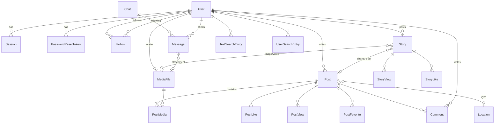

# Модель данных (кандидат)

> **Статус: 📝 черновик.** Это кандидатная модель, выведенная из исходного Swagger и требований.
> `schema.prisma` пишется по ней в соответствующих фазах, а не целиком заранее.
> Неопределённые связи и правила удаления отмечены ❓ со ссылкой на вопрос в
> [REQUIREMENTS.md](../REQUIREMENTS.md#5-открытые-вопросы).

## 1. Общие правила

- Все первичные ключи — UUID (`@default(uuid())`). Обоснование — [DATABASE_DECISIONS.md](DATABASE_DECISIONS.md#идентификаторы).
- У каждой таблицы `createdAt`; у изменяемых — `updatedAt`.
- Имена моделей и полей — английские, camelCase (стандарт Prisma); таблицы — как имена моделей.
- Счётчики (лайки, комментарии, подписчики) **вычисляются** запросом `_count`, а не хранятся.
  Денормализация — только если появится доказанная проблема производительности.

## 2. Диаграмма

## 3. Сущности

### Аккаунт

| Модель | Поля | Ограничения | Источник |
|---|---|---|---|
| `User` | `id`, `userName`, `email`, `fullName`, `passwordHash`, `role` (`USER`/`ADMIN`), `about?`, `gender?`, `avatarMediaId?`, `createdAt`, `updatedAt` | `userName` и `email` уникальны, хранятся в нижнем регистре | #1 RegisterDto, #54 UpdateUserProfileDto, #56 |
| `Session` | см. [AUTHENTICATION.md](../architecture/AUTHENTICATION.md#1-модель) | `tokenHash` уникален; индекс по `userId` | наше решение |
| `PasswordResetToken` | `id`, `userId`, `tokenHash`, `expiresAt`, `usedAt?`, `createdAt` | `tokenHash` уникален | #3, #4 |

- Профиль хранится в `User` (связь 1:1 не нужна) — см. DATABASE_DECISIONS.md.
- `gender` — enum, значения ❓ Q9 (в Swagger `0/1` без подписей). До ответа — nullable.
- `role` ❓ Q6 — поле добавляется, административные функции — нет.

### Медиа

| Модель | Поля | Комментарий |
|---|---|---|
| `MediaFile` | `id`, `ownerId`, `storageKey`, `kind` (`IMAGE`/`VIDEO`), `mimeType`, `sizeBytes`, `width?`, `height?`, `durationSec?`, `createdAt` | метаданные файла; сам файл — в хранилище по `storageKey` |
| `PostMedia` | `postId`, `mediaId`, `position` | PK (`postId`, `position`); `mediaId` уникален (файл принадлежит одному посту) |

Один `MediaFile` используется ровно в одном месте (пост, сторис, аватар или сообщение). Это упрощает
удаление: удалили владельца → удалили файл.

### Подписки

| Модель | Поля | Ограничения |
|---|---|---|
| `Follow` | `followerId`, `followingId`, `createdAt` | PK (`followerId`, `followingId`); `followerId ≠ followingId` (проверка в сервисе + CHECK в миграции) |

### Посты и взаимодействия

| Модель | Поля | Ограничения / вопросы |
|---|---|---|
| `Post` | `id`, `authorId`, `title?`, `content?`, `isReel`, `locationId?`, `createdAt`, `updatedAt` | `isReel` — Q10; `locationId` — Q20; индекс (`authorId`, `createdAt`) |
| `PostLike` | `userId`, `postId`, `createdAt` | PK (`userId`, `postId`) — один лайк от пользователя |
| `PostView` | `userId`, `postId`, `viewedAt` | PK (`userId`, `postId`) — уникальные просмотры (Q14) |
| `PostFavorite` | `userId`, `postId`, `createdAt` | PK (`userId`, `postId`) |
| `Comment` | `id`, `postId`, `authorId`, `text`, `createdAt` | индекс (`postId`, `createdAt`); ответов на комментарии нет |

`title` и `content` взяты из #26. Нужны ли оба поля в интерфейсе (у Instagram только подпись) — уточняется
в спецификации постов; в БД оба nullable.

### Сторис

| Модель | Поля | Ограничения / вопросы |
|---|---|---|
| `Story` | `id`, `authorId`, `mediaId?`, `sharedPostId?`, `createdAt`, `expiresAt` | ровно одно из `mediaId`/`sharedPostId` (CHECK); `expiresAt = createdAt + 24 ч` (Q11); индекс (`authorId`, `expiresAt`) |
| `StoryView` | `storyId`, `viewerId`, `viewedAt` | PK (`storyId`, `viewerId`) |
| `StoryLike` | `storyId`, `userId`, `createdAt` | PK (`storyId`, `userId`) |

❓ Q12: что происходит со сторис, если исходный пост удалён (по умолчанию — сторис тоже удаляется, `onDelete: Cascade`).

### Чаты

| Модель | Поля | Ограничения / вопросы |
|---|---|---|
| `Chat` | `id`, `user1Id`, `user2Id`, `createdAt`, `updatedAt` | только 1:1 (как в #8); `user1Id < user2Id`, уникальная пара — один чат на двоих |
| `Message` | `id`, `chatId`, `senderId`, `text?`, `attachmentMediaId?`, `createdAt` | хотя бы одно из `text`/`attachmentMediaId`; индекс (`chatId`, `createdAt`) |

❓ Q16: удаление чата — для обоих (физически) или «скрыть у себя» (тогда понадобится поле
`user1DeletedAt`/`user2DeletedAt`). ❓ Q18: прочитанность (поле `lastReadAt` у участника).
Две колонки вместо таблицы участников — потому что групповых чатов в контракте нет; это проще объяснить
и проще запросы. При появлении групповых чатов — миграция на `ChatParticipant`.

### История поиска

| Модель | Поля | Ограничения |
|---|---|---|
| `TextSearchEntry` | `id`, `userId`, `text`, `createdAt` | уникальная пара (`userId`, `text`) — повтор обновляет `createdAt` |
| `UserSearchEntry` | `id`, `userId`, `searchedUserId`, `createdAt` | уникальная пара (`userId`, `searchedUserId`) |

### Локации

| Модель | Поля | Вопросы |
|---|---|---|
| `Location` | `id`, `city`, `state`, `zipCode`, `country`, `createdAt` | Q20: связь с постами (`Post.locationId`), уникальность комбинации, кто создаёт |

### Уведомления — не моделируются ❓ Q21

Возможная форма после согласования: `Notification { id, recipientId, actorId, type, postId?, commentId?, readAt?, createdAt }`.

## 4. Правила удаления (черновик)

| Удаляется | Что происходит | Статус |
|---|---|---|
| `User` | каскадно: сессии, токены, посты, комментарии, лайки, просмотры, избранное, сторис, подписки, история поиска, медиафайлы | ❓ Q7 (жёсткое удаление по умолчанию) |
| `User` → его сообщения и чаты | по умолчанию чаты удаляются вместе с сообщениями | ❓ Q7, Q16 |
| `Post` | каскадно: `PostMedia` + файлы, лайки, просмотры, избранное, комментарии; сторис с этим постом | ❓ Q12 |
| `Story` | каскадно: просмотры, лайки, файл | — |
| `Comment`, `Message` | файл вложения (для сообщения) | — |
| `Location` | у постов `locationId` → `null` | ❓ Q20 |
| Аватар | `MediaFile` и файл в хранилище | — |

Файлы в хранилище удаляются **после** успешной транзакции БД. Если удаление файла не удалось — ошибка
логируется (файл-«сирота» не ломает данные); периодическая очистка — с появлением BullMQ.
