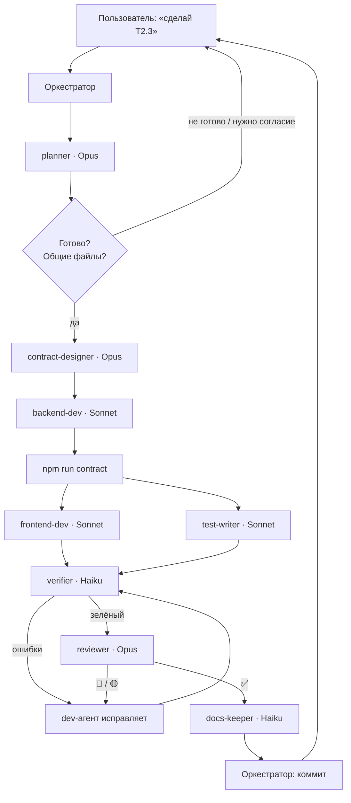

# ИИ-агенты проекта (subagents)

> Статус: ✅ принято ([ADR 0009](../decisions/0009-ai-subagents.md)). Определения агентов — `.claude/agents/*.md`
> (формат Claude Code). Документ описывает роли, выбор моделей и порядок совместной работы — для людей и любых ИИ.

## 1. Принцип выбора модели

Модель выбирается по **цене ошибки** и характеру работы, а не по «важности» задачи.

| Модель | Роль | Где | Почему |
|---|---|---|---|
| **Opus** | думает | план, контракт и схема БД, ревью безопасности | ошибка дорогая: неверный план или дыра в правах ломают работу обоих студентов; нужен глубокий анализ |
| **Sonnet** | делает | код backend, frontend, тесты | основной объём работы по чёткому плану; хорошее качество кода, быстрее и дешевле Opus |
| **Haiku** | рутина | запуск проверок, обновление STATUS.md, ссылки | механические, частые, малорискованные действия |

## 2. Агенты

| Агент | Модель | Может менять | Вход | Выход |
|---|---|---|---|---|
| [`planner`](../../.claude/agents/planner.md) | Opus | ничего | ID задачи | готовность, вопросы, общие файлы, шаги по агентам, риски |
| [`contract-designer`](../../.claude/agents/contract-designer.md) | Opus | `API_CONTRACT.md`, `docs/database/*`, `schema.prisma`, миграции | шаг плана + согласие пользователя на общие файлы | изменения API/данных, миграция, указания dev-агентам |
| [`backend-dev`](../../.claude/agents/backend-dev.md) | Sonnet | `apps/api` (кроме prisma и общих файлов без указания) | шаг плана | реализованные endpoint'ы, результат lint/typecheck, что покрыть тестами |
| [`frontend-dev`](../../.claude/agents/frontend-dev.md) | Sonnet | `apps/web` (кроме общих файлов без указания) | шаг плана, сгенерированные типы | страницы, компоненты, хуки, инвалидация, состояния |
| [`test-writer`](../../.claude/agents/test-writer.md) | Sonnet | только тесты | что реализовано | тесты, покрытие критериев приёмки, найденные ошибки |
| [`verifier`](../../.claude/agents/verifier.md) | Haiku | ничего | объём `api`/`web`/`all` | таблица проверок, ошибки `файл:строка` |
| [`reviewer`](../../.claude/agents/reviewer.md) | Opus | ничего | diff | 🔴/🟡/🟢 замечания, вердикт |
| [`docs-keeper`](../../.claude/agents/docs-keeper.md) | Haiku | новые файлы `docs/stories/`, `docs/STATUS.md`, `REQUIREMENTS.md` §5 | факты от оркестратора | история, обновлённый STATUS, список мест для правки по `Qn` |

Агентов на каждый модуль (`posts-agent`, `chat-agent`) нет: их инструкции совпадали бы. Модуль и владелец
передаются в задании. Оба студента используют один набор агентов.

## 3. Оркестратор

Оркестратор — **основная сессия** Claude Code, с которой общается пользователь. Только он:

- общается с пользователем и получает подтверждения (общие файлы, ломающие изменения, новые зависимости);
- вызывает агентов и передаёт им результаты друг друга (агенты не вызывают агентов и не видят разговор);
- принимает решение по отклонениям и замечаниям;
- **делает коммиты** (агенты никогда не коммитят).

Каждый агент стартует «с нуля»: он видит только репозиторий и текст задания. Поэтому задание всегда содержит
ID задачи, модуль, владельца, конкретный шаг плана и результаты предыдущих агентов, которые ему нужны.

## 4. Стандартный конвейер задачи



| Шаг | Когда пропускать |
|---|---|
| `planner` | задача из одного-двух файлов с очевидным решением — оркестратор планирует сам |
| `contract-designer` | контракт и схема не меняются |
| `backend-dev` / `frontend-dev` | задача затрагивает только одно приложение |
| `test-writer` | изменение только документации или конфигурации |
| `verifier` | никогда, если менялся код |
| `reviewer` | только документация; для мелких правок без прав доступа — по решению оркестратора |
| `docs-keeper` | никогда в конце задачи или сессии |

`frontend-dev` и `test-writer` работают **параллельно**, когда типы сгенерированы: они не трогают одни и те же файлы.
Цикл `verifier → исправление → verifier` идёт на дешёвой модели и может повторяться.

## 5. Передача результатов между агентами

Оркестратор передаёт **выжимку**, а не весь отчёт:

| От → к | Что передать |
|---|---|
| planner → любой | строку своего шага из таблицы «Шаги», значения по умолчанию `Q`, риски для этого шага |
| contract-designer → backend-dev | таблицу API, изменения данных, «Для backend-dev» |
| backend-dev → frontend-dev | список endpoint'ов, подтверждение, что `npm run contract` выполнен |
| backend-dev / frontend-dev → test-writer | изменённые файлы, «что обязательно покрыть» |
| verifier → dev-агент | только ошибки его приложения (`файл:строка — сообщение`) |
| reviewer → dev-агент | только 🔴 и 🟡 по его файлам |
| все → docs-keeper | факты для истории: запрос, время начала, кто и какие агенты работали, что сделано, решения, файлы, проверки с результатами, проблемы, что дальше; статусы задач; закрытые `Q` |

## 6. Пример задания агенту

```
Задача T2.3 (posts), владелец — Студент B. Шаг 3 из плана planner:
«Реализовать POST /posts и DELETE /posts/{postId} в apps/api/src/posts/ по API_CONTRACT §2.4».
Контракт и модели Post/PostMedia уже добавлены contract-designer (миграция add_posts создана).
Ограничения: files 1–10 изображений ≤ 10 МБ (SECURITY.md); удалять может только автор.
Общие файлы: разрешена только регистрация PostsModule в app.module.ts.
После реализации выполни npm run contract.
```

## 7. Правила для всех агентов

- Читать `AGENTS.md` перед работой; не нарушать его жёсткие правила.
- Не выходить за свой шаг и свои файлы; при выходе за границы — остановиться и сообщить.
- Не придумывать API, поля, правила; неизвестное — вопрос.
- Не читать `.env`; не коммитить, не пушить, не создавать ветки.
- Сообщать только о реально выполненных проверках.
- Отвечать на русском в формате, заданном в определении агента.

## 8. Изменение агентов

- Определения агентов (`.claude/agents/`) — общие файлы: меняются через коммит с ревью второго студента.
- Смена модели агента или добавление нового агента — обновить этот документ и ADR 0009 (или новый ADR при смене принципа).
- Поле `effort` в определениях задаёт глубину рассуждения (high — Opus-агенты, medium — Sonnet, low — Haiku).
